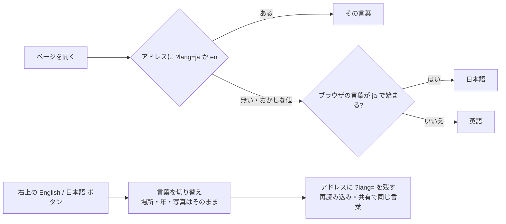
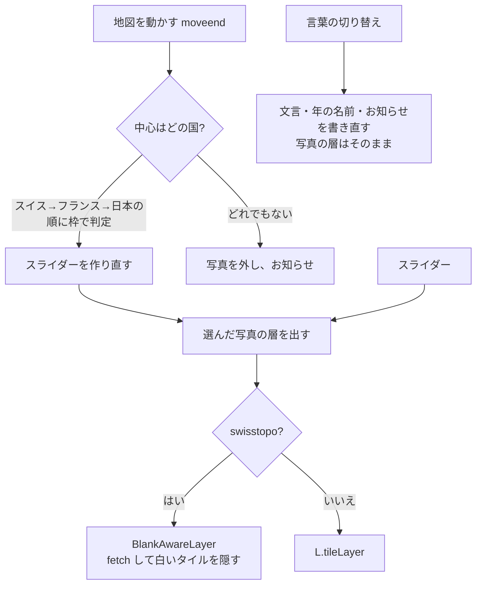

# 海外の空中写真 試作（overseas-test.html）設計

- 作成: 2026-10-27
- 位置づけ: **試作。公開中のサイトには入れない**（下の「公開サイトへの影響」）
- 前提の調査: [`docs/spec/overseas_sources_research.md`](../spec/overseas_sources_research.md)

## 1. 目的

1. スイス・フランス・ウィーン・ルール地方・スペインの昔の空中写真が、日本と同じように今の地図へ重なるかを画面で確かめる
   （ウィーン・ルール地方・スペインは 2026-10-27 の2回目の調査を受けて追加）
2. 時間スライダーには、**その場所にある年だけ**を並べる（スイス100時点・フランス2・日本9）
   - 3回目までは「A 国ごとの年」と「B 年代でそろえる（1920〜2020年代の11区切り）」を切り替えて比べていた。
     2026-10-27 オーナー判断で **A に決め、B と切り替えはやめた**（国をまたいで見比べる使い方は想定しない。切り替えの意味が伝わらなかった）
3. 外国の人も見られるよう、**日本語と英語を切り替えられる**ようにする（2026-10-27 オーナー了承。4回目で追加）

## 2. 公開サイトへの影響


- 2026-10-27 ユーザー指示により、**公開サイトにリンクを張らずに置く**（直アドレスで確認するため）。
  確認用 URL: https://immersamap.github.io/overseas-test.html
- 既存のページ・SQL・画像は変えていない。どのページからもリンクせず、`sitemap.xml` にも入れない
- ページには `noindex, nofollow` を付け、検索に出ないようにする
- テストコードと `requirements-dev.txt` は `_config.yml` の `exclude` で配信しない

## 3. 画面

```text
┌───────────────────────────┐                 [English]
│ 海外の空中写真 [試作]        │                       [+]
│ 場所  [🇨🇭 スイス  場所を変える ▾] │                       [−]
│                           │      地図（OSM の上に写真）
│ スイス の写真                │
│ 1946年  白黒・ほぼ全域        │
│ ●────────────────○    │
│ |||||||||||||||||||| ← 目盛り（灰色は写真なし）│
│ 1926年          最新        │
│ ⚠ お知らせ（写真なし・読めない）│
│ 年を選ぶ [1945年][1946年]…   │                 濃さ（右の縦スライダー）
│ 出典: © swisstopo           │
└───────────────────────────┘
```

### スマホ（2026-10-27 UI/UX レビュー3回。記録: [`docs/ui/overseas_prototype_mobile_review.md`](../ui/overseas_prototype_mobile_review.md)）

縦（幅 600px 以下）と横（高さ 500px 以下）を `body.compact` にして、操作板を**畳めるシート**にする。

```text
縦 390×844
┌────────────────────────┐
│[🇨🇭 スイス 場所を変える▾][English]│ ← 場所: 今いる国の旗と名前。押すと国ごとの一覧
│                     [+]│   言葉: 右上。押すと日本語⇔英語
│                     [−]│
│                    ┌─┐│
│     地図（約81%）     │濃│ ← 写真の濃さ: 公開中の /map/ と同じ縦スライダー
│                    │さ│
│                    └─┘│
├────────────────────────┤
│ ▬ 詳しい操作を開く          │ 畳んで 162px
│ 1946年 白黒・ほぼ全域       │
│ [◀] ────●──────── [▶]    │ ◀▶ は 44px
│ 1926年            最新    │ ← 両端の年（小さく）
│ 出典: swisstopo 背景: OSM  │
├──── 開くと（最大 60%）─────┤
│ 年を選ぶ [1945年][1946年][1947年]… │ ← 選んだ年を真ん中へ
│ 見出し・説明              │
└────────────────────────┘

場所の一覧（国ごとに1行。都市が増えても画面のボタンは増えない）
┌──────────────────────────┐
│ 🇯🇵 日本        [東京]           │
│ 🇨🇭 スイス      [チューリッヒ]    │
│ 🇫🇷 フランス    [パリ]           │
│ 🇦🇹 オーストリア [ウィーン]       │
│ 🇩🇪 ドイツ      [エッセン]        │
│ 🇪🇸 スペイン    [マドリード][バルセロナ] │
└──────────────────────────┘
```

- 横画面は、操作板を左の幅 300px の帯（高さは中身だけ）にし、濃さのスライダーは右下
- 場所の一覧では今いる国の行に印を付けて、そこまで送る。10か国を超えたら地域の見出し、30か国を超えたら検索欄を考える
- PC（上のどちらでもない）は左上の操作板のまま。場所の一覧はパネルの中に開く。濃さは地図の右側
- 国旗は SVG で描く（Windows は国旗の絵文字を出せない）。図の 🇨🇭 は説明のための表記
- 「今と比べる（押している間）」ボタンは3回目でやめた。濃さのスライダーと役割が重なり、公開中の /map/ とも操作がそろわないため
- 押す所はスマホで 44px 以上（場所の一覧の都市は 36px）
- 国は**地図の中心**で決める。動かして国が変わったら、スライダーを作り直し、**前に見ていた年に近い写真**を選び直す
  （例: 日本の 1974〜78年のままスイスへ → 1974年、ウィーンへ → 1976年、フランスへ → 1950〜65年。国境付近では中心のある国の写真だけが出る）
- 選び直しの基準は**利用者が最後に選んだ年**（`wantYear`。スライダー・◀▶・チップで選んだときだけ変わる）。
  直前の国で自動で選ばれた年を基準にすると、スイス 1927年 → パリ（1950〜65年）→ スイスで 1950年になり、元の年に戻らない（UIレビュー4回目 R1）
- 開いたシートの高さは、縦の画面で `min(60vh, 画面の高さ − 354px)` まで。右の濃さのスライダー（下端 344px）にかぶらない。入りきらない分はシートの中で送る（R3）

### 言葉（日本語・英語。4回目で追加）



- 言葉で変わるものは `[日本語, 英語]` の組で持つ（国名・都市名・写真の説明・出典・お知らせ・画面の文言）
- 年の名前は日本語だけ持ち、英語は撮影年から作る（`1973–1986`・`c. 1928`・`Latest`）
- お知らせは「種類」だけを覚え、言葉を変えたら書き直す
- 言葉を変えても写真の層は作り直さない（読み直しで地図がちらつかないように）
- スマホでは、場所のボタンの幅に上限（画面幅 − 104px）を付けて言葉のボタンにかからないようにする。
  国名が切れるときだけ「場所を変える」を隠し、▾ だけにする（例: 390px の「オーストリア・ウィーン」）
- 言葉のボタンは右上（ズームの上）。外国の人が最初に目にする場所に置く。ボタンの文字は切り替え先の言葉で書く（English／日本語）

## 4. 構成



### 写真の層

| 国 | 層 | 最大ズーム（配信） | 出典 |
|---|---|---|---|
| 日本 | 国土地理院 9世代（地図探索モードと同じ） | 17〜18 | 国土地理院 |
| スイス | `swissimage-product` の 1926〜2025年（1928年は無し）＋最新。**1946年だけ** `swissimage-product_1946` | 20（1946年は17） | © swisstopo |
| フランス | `ORTHOIMAGERY.ORTHOPHOTOS.1950-1965`、最新は `ORTHOIMAGERY.ORTHOPHOTOS` | 18／19 | IGN（Licence Ouverte 2.0） |
| ウィーン | `lb1938`・`lb1956`・`lb1976`・`lb1992`（白黒 `grau`）、最新は `lb`（`farbe`）。XYZ で **{y}/{x} の順** | 19 | Stadt Wien（CC BY 4.0） |
| ルール地方 | WMS `lubi_1926`・1934・1952・1963・1969・1990・1998、最新は NRW の `nw_dop_rgb` | 19 | RVR（dl-de/by-2-0）・Geobasis NRW（dl-de/zero-2-0） |
| スペイン | WMS `pnoa-historico` の `AMS_1956-1957`・`Interministerial_1973-1986`・`Nacional_1981-1986`・`SIGPAC`、最新は `pnoa-ma` | 18〜19 | IGN España（CC BY 4.0） |

- WMS は `L.tileLayer.wms`（PNG・透明）で読む。範囲外は 200 で空の小さい PNG が返るので、swisstopo の白いタイルと同じ仕組み（`blankAware`）で「写真なし」と数える
- 地域の範囲は**多角形の組**（`[緯度, 経度]`）。四角は `box()` で多角形にする。地図の中心が中にあるかを、横に線を引いて辺をまたぐ回数で判定する
- **スイス・フランスは国境をおおまかになぞった多角形**（それぞれ約20・35点。フランスはコルシカ島の四角も持つ）。
  3回目までの四角では、シュトゥットガルト・トリノ・ブリュッセル・アンドラが「フランス」、ミラノが「スイス」になり、
  国旗と国名を出す今の画面では誤りがそのまま見えた（UIレビュー4回目 R2）。いまは対象外になる
- 国境のすぐ近くは粗い（例: ジュネーブの隣のアンヌマス＝フランスは「スイス」になる。モナコは「フランス」）。本実装では国境のデータ（`coverage_polygons` 等）を使う
- スペインは本土南側＋ピレネーより西の北側の2つの四角にして、フランス南部（ペルピニャン）を取らない

## 5. 異常系

| 場面 | 起きること | 対処 |
|---|---|---|
| 配信元が止まる・つながらない（タイルが全部失敗） | 写真が出ない | 表示中のタイルが**1枚も読めなかった**ときだけ「読み込めませんでした」と出す。他の操作は続けられる |
| 一部のタイルだけ失敗 | 端が欠ける | 撮影範囲の外であることが多いので、お知らせは出さない |
| **swisstopo の白いタイル** | 写真の無い所に、HTTP 200 で 668 バイトの真っ白な JPEG が返る。そのままだと地図に白い膜がかかる（1946年のチューリッヒは z16 以下がすべて白） | `fetch` で中身の大きさを見て、1000 バイト未満は**隠して「写真なし」と数える**。表示中が全部白なら「この年の写真がありません」と出す |
| 対象外の国 | 写真が無い | 写真を外し、スライダーを止め、「日本・スイス・フランスだけ」と案内する |
| `?lang=` がおかしな値 | — | 無視して、ブラウザの言葉で開く |
| アドレスに言葉を残せない（`file://` など） | `history.replaceState` が例外 | 無視する。画面の切り替えは済んでいる |
| 長い国名（スマホ） | 場所のボタンが右上の言葉のボタンにかかる・折り返す | 幅に上限を付け、国名が切れるときだけ「場所を変える」を隠す |
| 動かしたあと | 前の場所の数が残ると、誤ったお知らせが出る | 層の `loading`（読み込み開始）ごとに数え直し、お知らせを消す |
| スライダーを指でなぞる | 1段ごとに層を作ると、途中の年を全部読みに行く（最新→1946年で 972 枚） | 指が動いている間は年の表示だけ変える。離したとき（`change`）か、止まって 250ms 後に読む |
| 年を切り替えた直後 | 層を外してから読むと、背景の地図がちらつく | 前の層は新しい層の `load` まで残す。数え・お知らせは表示中の層の分だけ |
| ウィーンの市外 | 配信元が 404 を返す | 地域の枠をウィーン市内にしぼり、市外は「対象外」として扱う |

- タイムアウト・リトライは Leaflet とブラウザに任せる（試作のため。本実装で決める）
- 静的ページで状態を持たないので、再読み込みすれば初期状態（東京・最新）に戻る。言葉だけはアドレスの `?lang=` で引き継ぐ

## 6. 試作で割り切ったこと（本実装で決める）

- 日本の古い写真の色合わせ（地図探索モードの `unify-pink` フィルタ）は入れていない
- 英語にしたのはこの試作の画面だけ。トップページ・`/map/`・物語のページの英語版は、別に決める
- 国の判定はおおまかな多角形。国境のすぐ近くは誤ることがある（上の「写真の層」の注記）
- Supabase の `coverage_polygons`・古地図・地形・検索・現在地は入れていない
- スイスの写真は「年ごとに写る範囲が違う」。どの年がどこを写しているかの一覧は、配信元から取れていない
