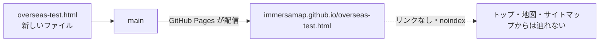
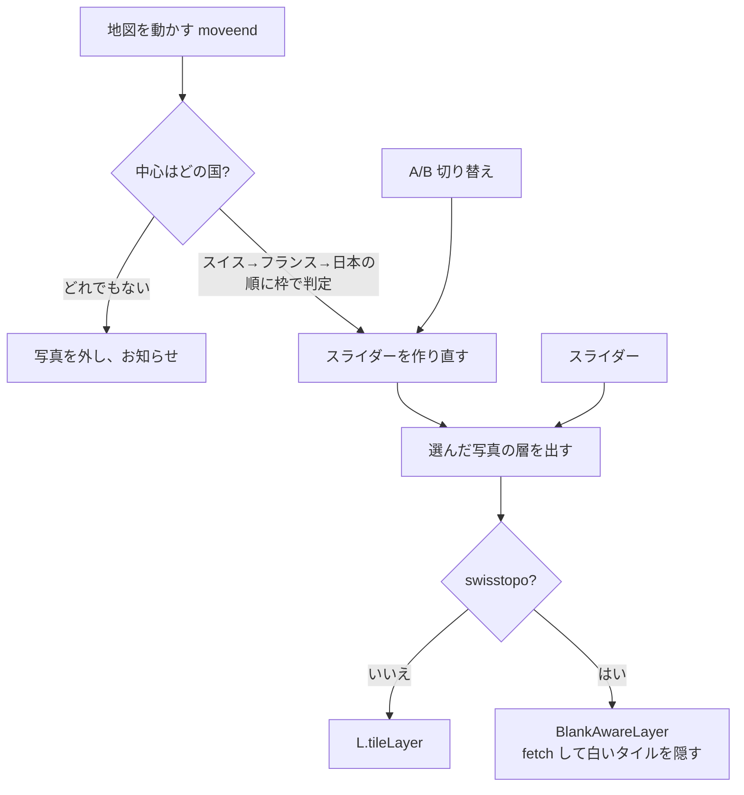

# 海外の空中写真 試作（overseas-test.html）設計

- 作成: 2026-10-27
- 位置づけ: **試作。公開中のサイトには入れない**（下の「公開サイトへの影響」）
- 前提の調査: [`docs/spec/overseas_sources_research.md`](../spec/overseas_sources_research.md)

## 1. 目的

1. スイス・フランスの昔の空中写真が、日本と同じように今の地図へ重なるかを画面で確かめる
2. 時間スライダーの「年代の並べ方」を、実物を触って決められるようにする
   - **A 国ごとの年:** その国にある写真をそのまま並べる（スイス100時点・フランス2・日本9）
   - **B 年代でそろえる:** 1920〜2020年代の11区切りに共通化し、写真の無い年代は空ける

## 2. 公開サイトへの影響



- 2026-10-27 ユーザー指示により、**公開サイトにリンクを張らずに置く**（直アドレスで確認するため）。
  確認用 URL: https://immersamap.github.io/overseas-test.html
- 既存のページ・SQL・画像は変えていない。どのページからもリンクせず、`sitemap.xml` にも入れない
- ページには `noindex, nofollow` を付け、検索に出ないようにする
- テストコードと `requirements-dev.txt` は `_config.yml` の `exclude` で配信しない

## 3. 画面

```text
┌───────────────────────────┐                       [+]
│ 海外の空中写真 [試作]        │                       [−]
│ 場所  [東京][チューリッヒ][パリ] │
│ 年代の並べ方 [A 国ごとの年][B 年代でそろえる] │      地図（OSM の上に写真）
│ スイス の写真                │
│ 1946年  白黒・ほぼ全域        │
│ ●────────────────○    │
│ |||||||||||||||||||| ← 目盛り（灰色は写真なし）│
│ 1926年          最新        │
│ ⚠ お知らせ（写真なし・読めない）│
│ 写真の濃さ 80%  ────●──     │
│ 出典: © swisstopo           │
└───────────────────────────┘
```

- スマホ（幅 600px 以下）では操作板を画面の下に寄せる
- 国は**地図の中心**で決める。動かして国が変わったら、スライダーを作り直し、**前に見ていた年に近い写真**を選び直す

## 4. 構成



### 写真の層

| 国 | 層 | 最大ズーム（配信） | 出典 |
|---|---|---|---|
| 日本 | 国土地理院 9世代（地図探索モードと同じ） | 17〜18 | 国土地理院 |
| スイス | `swissimage-product` の 1926〜2025年（1928年は無し）＋最新。**1946年だけ** `swissimage-product_1946` | 20（1946年は17） | © swisstopo |
| フランス | `ORTHOIMAGERY.ORTHOPHOTOS.1950-1965`、最新は `ORTHOIMAGERY.ORTHOPHOTOS` | 18／19 | IGN（Licence Ouverte 2.0） |

### B の代表の選び方

その年代（例 1950〜1959年）に**撮影期間が少しでもかかる写真のうち、いちばん新しいもの**を代表にする。
「最新」の層は 2020年代にだけ使う。結果:

| 年代 | 1920 | 1930 | 1940 | 1950 | 1960 | 1970 | 1980 | 1990 | 2000 | 2010 | 2020 |
|---|---|---|---|---|---|---|---|---|---|---|---|
| 日本 | 1928 | 36〜42 | 45〜50 | 45〜50 | 61〜69 | 79〜83 | 87〜90 | 87〜90 | — | — | 最新 |
| スイス | 1929 | 1939 | 1949 | 1959 | 1969 | 1979 | 1989 | 1999 | 2009 | 2019 | 2025 |
| フランス | — | — | — | 50〜65 | 50〜65 | — | — | — | — | — | 最新 |

## 5. 異常系

| 場面 | 起きること | 対処 |
|---|---|---|
| 配信元が止まる・つながらない（タイルが全部失敗） | 写真が出ない | 表示中のタイルが**1枚も読めなかった**ときだけ「読み込めませんでした」と出す。他の操作は続けられる |
| 一部のタイルだけ失敗 | 端が欠ける | 撮影範囲の外であることが多いので、お知らせは出さない |
| **swisstopo の白いタイル** | 写真の無い所に、HTTP 200 で 668 バイトの真っ白な JPEG が返る。そのままだと地図に白い膜がかかる（1946年のチューリッヒは z16 以下がすべて白） | `fetch` で中身の大きさを見て、1000 バイト未満は**隠して「写真なし」と数える**。表示中が全部白なら「この年の写真がありません」と出す |
| 対象外の国 | 写真が無い | 写真を外し、スライダーを止め、「日本・スイス・フランスだけ」と案内する |
| B で写真の無い年代 | — | 写真を外し、「この年代の写真がありません」と出す。目盛りを灰色にして、事前に分かるようにする |
| 動かしたあと | 前の場所の数が残ると、誤ったお知らせが出る | 層の `loading`（読み込み開始）ごとに数え直し、お知らせを消す |

- タイムアウト・リトライは Leaflet とブラウザに任せる（試作のため。本実装で決める）
- 静的ページで状態を持たないので、再読み込みすれば初期状態（東京・A・最新）に戻る

## 6. 試作で割り切ったこと（本実装で決める）

- 日本の古い写真の色合わせ（地図探索モードの `unify-pink` フィルタ）は入れていない
- 国の判定は四角い枠。国境付近（ジュネーブ等）はスイスが優先される
- Supabase の `coverage_polygons`・古地図・地形・検索・現在地は入れていない
- スイスの写真は「年ごとに写る範囲が違う」。どの年がどこを写しているかの一覧は、配信元から取れていない
