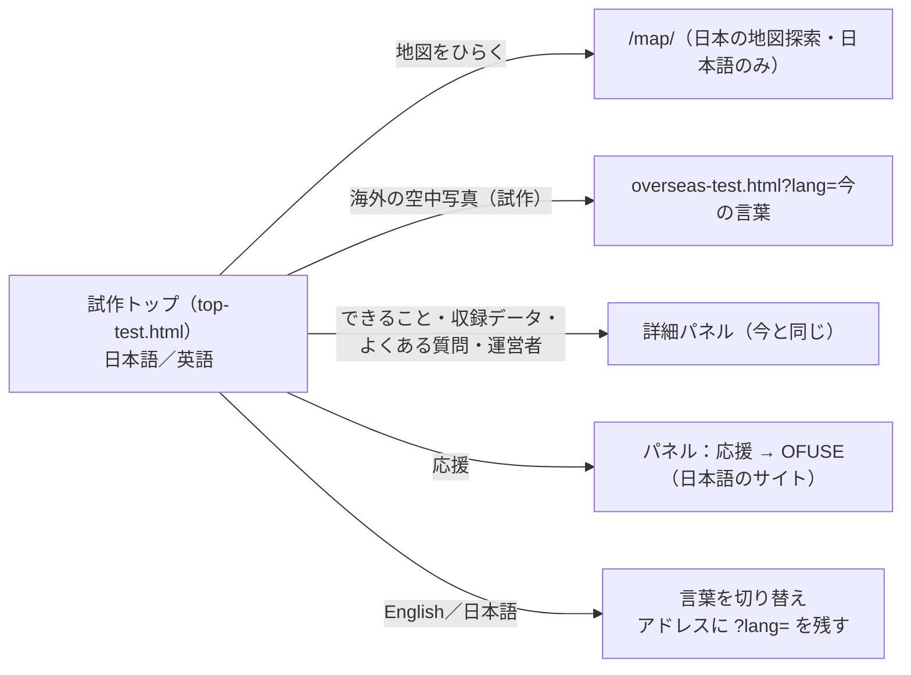

# 試作トップページ（top-test.html）仕様・画面・設計

- 作成: 2026-10-27
- 位置づけ: **試作。公開中のトップページ（`/`）は変えない**
- 確認用 URL: https://immersamap.github.io/top-test.html （どこからもリンクしない・`noindex`）
- もとにしたもの: 公開中の `index.html`（デザイン「ノワール」。[`docs/ui/top_redesign_noir.md`](../ui/top_redesign_noir.md)）

## 1. 目的・背景

- オーナーから「外国の人も見ることを想定すると、英語表記のほうがよい」（2026-10-27）。ブラウザの自動翻訳では、
  英語で検索する人に見つけてもらえない・短い表示や固有名詞が崩れる、という説明をして、**英語版を試作で見てもらう**ことになった
- あわせて、試作中の「海外の空中写真」（`overseas-test.html`）への入口をトップに置いた形を見てもらう
- 本物のトップを差し替えるのは仕様変更なので、**試作を見てもらってから改めて承認を取る**

## 2. 機能一覧



| 機能 | 内容 |
|---|---|
| 今のトップと同じもの | 1936年／現在の写真の境目スライダー、見出し・説明、「地図をひらく」、詳細パネル（タブ5つ・`/#faq` 等で開く）、下帯 |
| 海外への入口（新） | 本文のボタンに「海外の空中写真（試作）」を足す。今の言葉を `?lang=` で引き継ぐ |
| 言葉の切り替え（新） | ヘッダーに「English／日本語」。最初は `?lang=` → ブラウザの言葉（`ja` で始まれば日本語、それ以外は英語）。押すと切り替え、アドレスに `?lang=` を残す（開いているパネルの `#faq` 等も残す） |
| 英語の本文（新） | 見出し・説明・ボタン・下帯・パネルの全文（FAQ 7件・年表・運営者・応援）を英語でも持つ |

### 英語のときに正直に伝えること

- `/map/` は日本の地図で、画面は日本語だけ。ボタンに「Japanese interface」と添える
- 古地図（1896年〜）は日本の首都圏だけ。英語でもそう書く
- 利用規約・プライバシーポリシー・OFUSE は日本語のページ。リンクに「(Japanese)」と添える

## 3. 非機能要件

| 項目 | 内容 |
|---|---|
| 公開サイトへの影響 | 新しいファイル `top-test.html` を足すだけ。`index.html`・`/map/`・`sitemap.xml`・`robots.txt` は変えない。どこからもリンクしない |
| 検索 | `noindex, nofollow`。構造化データ（JSON-LD）・canonical・OGP は**載せない**（本物のトップと重複させない） |
| 性能 | 写真・フォントは今のトップと同じものを使う（増やさない）。英語の文章を足しても HTML は +20KB 程度 |
| セキュリティ | 外部へ送るものは無い（今のトップと同じ）。`?lang=` は `ja`／`en` 以外を無視する |
| アクセシビリティ | `<html lang>` を言葉に合わせて変える。切り替えボタンには切り替え先の言葉で名前を付ける |

## 4. 制約・前提

- ローカルで Web サーバーは立てない。E2E は `file://` で開く（`/map/` などの絶対パスのリンクは、行き先ではなく `href` を確かめる）
- 物語のページ（`/okunohosomichi/`・`/ryoma/`）は `_config.yml` で非公開なので、入口は作らない
- 本物の英語版を出すときは、別途 `hreflang`・英語の構造化データ・`/map/` の英語化を決める（この試作の範囲外）
- **ブラウザの言葉で自動的に英語にするのは、この試作だけ。** 本物は英語版を別の URL（例 `/en/`）に置き、`hreflang` で日本語版と結ぶ。
  日本語の URL のまま自動で切り替えると、英語の設定で読みに来る検索エンジンに `/` が英語の画面として読まれ、日本語での検索順位が崩れる（レビュー R4）
- ロゴの行き先は、試作の間は `top-test.html?lang=<今の言葉>`（本物のトップへ飛ぶと、英語の人が日本語だけの画面に移り、言葉ボタンも無くなるため。R5）

## 5. 画面

```text
PC（1280×800）— 今のトップと同じ1画面
┌────────────────────────────────────────────────────────────┐
│ ◎ ImmersaMap     できること 収録データ よくある質問 ♡応援する [🌐 English] [地図をひらく] │
│                                                            │
│ ── OLD MAPS × AERIAL PHOTOS                                 │
│ 昔の地図と航空写真を、                    （1936 | NOW の写真と境目）│
│ 今の地図に重ねて見る。                                          │
│ 説明文                                                       │
│ [地図をひらく →] [海外の空中写真 試作] [収録データを見る]            │
│ ♡ 個人運営・広告なし ─ 応援はこちら                                │
│                                                            │
│ 1936—  1896—  Free                        出典・運営者・規約     │
└────────────────────────────────────────────────────────────┘

英語のとき
│ ◎ ImmersaMap   Features Data FAQ ♡Support [🌐 日本語] [Open the map] │
│ ── OLD MAPS × AERIAL PHOTOS                                 │
│ Old maps and aerial photos,                                 │
│ laid over today's map.                                      │
│ [Open the map of Japan →]  [Europe & Japan (prototype)]  [See the data] │
│   Japanese interface                                         │

スマホ（390×844）— 縦に流す（今と同じ）
┌──────────────────────┐
│ ◎ ImmersaMap  ♡応援 [🌐EN]  │ ← 言葉ボタンは短い表示（EN／日本語）。ヘッダーの「地図をひらく」は外す（R1）
│   （写真と境目）         │
│ 見出し・説明            │
│ [地図をひらく →]        │
│ [海外の空中写真 試作]    │
│ [収録データを見る]       │
└──────────────────────┘
```

## 6. 設計

- `index.html` を写し、次だけを変える
  - `<head>`: `noindex, nofollow`。JSON-LD・canonical・OGP を外す
  - 長い文章（本文・パネル）は**日本語と英語の両方を HTML に持ち**、`data-lang="ja|en"` を付けて、`<html lang>` に合わない方を CSS で隠す
    （JS で書き換えるより、文章の取り違え・訳の抜けを E2E で見つけやすい）
  - 隠す規則は `html:not([lang="en"]) [data-lang="en"], html[lang="en"] [data-lang="ja"]{display:none !important}`。
    `!important` が無いと `.cta{display:inline-flex}` などに負けて両方の言葉が出る（R3。共通ルールの「display を指定すると hidden が効かない」と同じ形）
  - 短い文言（`<title>`・`aria-label`・ボタン）は JS の辞書で書き換える
- 言葉の決め方と残し方は `overseas-test.html` と同じ（[`docs/design/overseas_prototype.md`](overseas_prototype.md) の「言葉」）
- 海外の入口の `href` は、言葉を切り替えるたびに `overseas-test.html?lang=<今の言葉>` に書き直す

## 7. 異常系

| 場面 | 起きること | 対処 |
|---|---|---|
| `?lang=` がおかしな値 | — | 無視して、ブラウザの言葉で開く |
| アドレスに残せない（`file://` 等で `history.replaceState` が例外） | — | 無視する。画面の切り替えは済んでいる |
| JavaScript が動かない | 両方の言葉の文章が出てしまう | `<html lang="ja">` を既定にし、CSS だけで英語を隠す（JS が動かなければ日本語だけが見える） |
| 写真が読めない | — | 今のトップと同じ（背景色のまま文字は読める） |
| パネルを開いたまま言葉を変える | パネルはモーダルなので、ヘッダーのボタンは押せない（`/#faq` で開いた外国の人が英語にできない） | パネルの上（タブの並び）にも言葉ボタンを置く。押すとパネルは開いたまま、同じタブの言葉だけ変わる（R2） |
| スマホのヘッダーが入りきらない | 言葉ボタンを足すと 360px で 73px（英語で 142px）はみ出し、`overflow-x:hidden` のため「地図をひらく」が黙って切れる | 760px 以下ではヘッダーから「地図をひらく」を外す（本文のすぐ下に同じボタンがある）。E2E で 360／390px のヘッダーの右端を測る（R1） |

## 8. 仮想レビュー（実装前・2026-10-27）

レビュワー: A 海外向け SEO・B 多言語化・C 地図／旅行サービスの UX・D スマホ優先のデザイン。今のトップを `file://` で開き、ヘッダーに言葉ボタンを入れた幅を測った。

| ID | 場所 | どう壊れるか | 重大度 | 対応 |
|---|---|---|---|---|
| R1 | スマホのヘッダー | 言葉ボタンを足すと 360px で 73px・英語で 142px はみ出し、「地図をひらく」が見えなくなる | 高 | 760px 以下ではヘッダーの「地図をひらく」を外す |
| R2 | 異常系「パネルを開いたまま言葉を変える」 | パネルはモーダルで、ヘッダーのボタンを押せない。記述と動きが食い違う | 低 | パネルの上にも言葉ボタンを置く |
| R3 | 言葉を隠す CSS | 詳しさで `.cta` 等に負け、両方の言葉が出る | 低 | `!important` 付きの規則にし、E2E で「もう一方の言葉で見えている要素が0件」を数える |
| R4 | 本物への持ち込み | 同じ URL で自動切り替えすると、検索エンジンに英語の画面として読まれる | 中 | 本物は `/en/`＋`hreflang`、自動切り替えは試作だけ、と §4 に書いた |
| R5 | ロゴのリンク | 英語の人が日本語だけの本物のトップへ移る | 低 | 試作の間は `top-test.html?lang=` へ |

判定: R1 を直し R2〜R5 を反映する条件で、4人とも LGTM。

## 9. 仮想レビュー（実装後・動く画面を通しで操作。2026-10-27）

同じ4人が、日本語・英語のブラウザで 360×640・390×844・1280×720・1440×900 を最初から通しで操作した（言葉の切り替え・パネル5タブ・境目のつまみ・海外の入口）。
R1〜R5 は直っていることを確かめた。新しい指摘:

| ID | 場所 | どう壊れるか | 重大度 | 対応 |
|---|---|---|---|---|
| F1 | スマホのパネル上部 | R2 で置いた言葉ボタンがタブと同じ行に入り、360px の日本語でタブが 168px しか見えない。「運営者」「応援する」が見えず、ほかのタブがあると分からない | 中 | スマホではタブを2行目に1行まるごと使わせ、パネルを画面いっぱいにした（ブラウザ既定の左の隙間 約38px も無くす）。「♡ 応援」と短くし、すき間と文字を少し詰めて 360px に5つ収めた |
| F2 | PC のパネルのタブ | 言葉ボタンのぶん「♡ 応援する」が切れる | 低 | パネルの中の言葉ボタンは常に短い表示（EN／日本語） |
| F3 | 英語の説明文と下帯 | 「Open any place」とあり、日本だけのデータだと分からない。英語圏の人が自分の街を見られると思って押す | 低〜中 | 「Open any place in Japan」「Aerial photos of Japan by era」にした |
| F4 | JavaScript が動かないときの言葉ボタン | 中身が空の枠が出て、押しても何も起きない | 低 | 言葉ボタンは最初は隠し、JavaScript が動いたときだけ出す |

判定: F1〜F4 を直す条件で4人とも LGTM。直したあと E2E に T11（タブが切れない・パネルが画面いっぱい）と T10・T2 の確認を足した。
