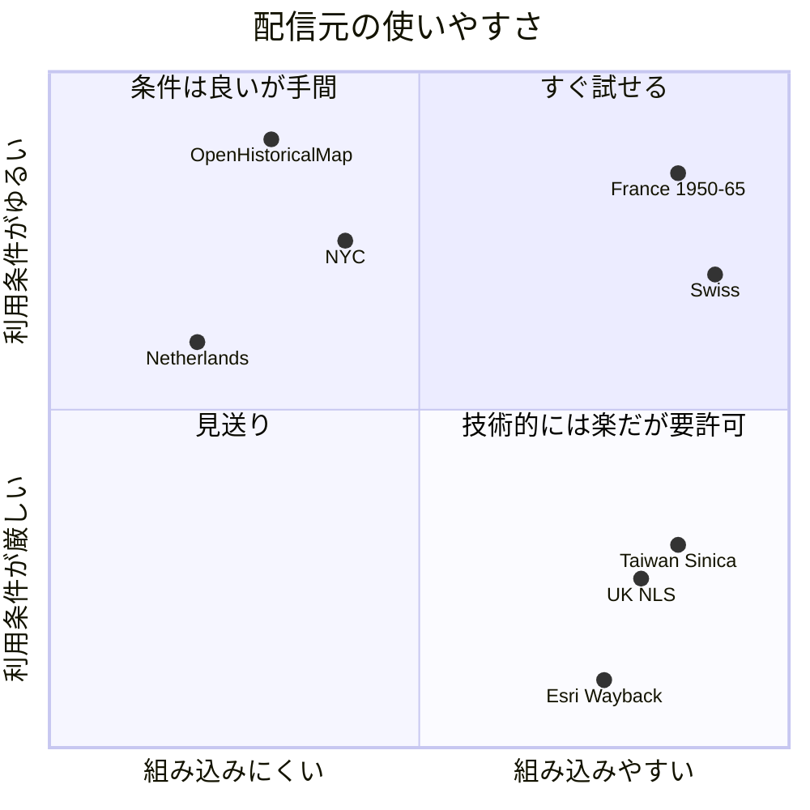
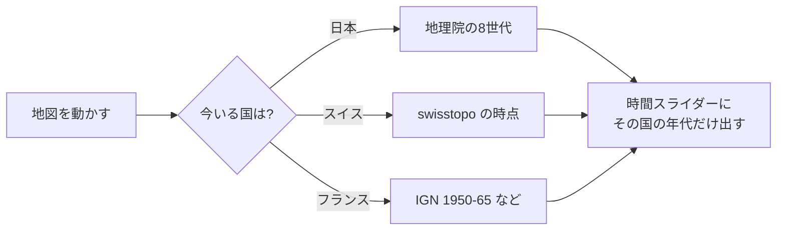

# 海外の古い空中写真・古地図 調査結果

- 調査日: 2026-10-27
- 目的: 地図探索モード（`/map/`）を海外に広げられるか、使える配信元を洗い出す
- 方法: 各配信元のタイルを実際に1枚取得し（HTTP ステータス・形式・CORS）、利用条件を一次資料で確認した
- 状態: **調査のみ。仕様・実装はまだ変えていない**

## 1. 結論

- **技術的には、今の地図にそのまま足せるものが複数ある。** スイス・フランス・台湾・イギリス（NLS）は、
  Leaflet の `L.tileLayer` にそのまま入る形（EPSG:3857 の `{z}/{x}/{y}`・キー不要・CORS 可）で配信されている
- **難しいのは利用条件。** 商用利用（今後の広告）まで認めると明記されているのはフランスだけ。
  スイスはほぼ可だが、1946年の写真に「有償」の記載があり要確認
- **最初の試作はスイスとフランスがよい。** 条件が最もはっきりしていて、年代も厚い
- 日本の歴史とつながる台湾・京城・満洲の地図は中央研究院（台湾）にまとまっているが、**非商用（CC BY-NC）**



## 2. 候補の一覧

「確認」は、タイルを実際に取得して中身（写真・地図）が写っていることを見たもの。

### 2.1 すぐ試せる

| 国 | レイヤ | 年代 | 範囲 | 確認 | キー | 利用条件 |
|---|---|---|---|---|---|---|
| スイス | 空中写真の時系列 `ch.swisstopo.swissimage-product` | **1926〜2025（約100時点）** | スイス・最大 z20 | ✅ | 不要 | ©swisstopo・商用可（注1） |
| スイス | 1946年の白黒写真 `ch.swisstopo.swissimage-product_1946` | 1946 | ほぼ全域・z17 | ✅ | 不要 | 同上（注1） |
| スイス | 地図の時間旅行 `ch.swisstopo.zeitreihen` | **1844〜2021（178時点）** | スイス・z18 | ✅ | 不要 | 同上 |
| フランス | 空中写真 `ORTHOIMAGERY.ORTHOPHOTOS.1950-1965` | 1950〜1965 | 本土と海外県・z18 | ✅ | 不要 | Licence Ouverte 2.0（**商用可**・出典表示） |
| フランス | 参謀本部図 `GEOGRAPHICALGRIDSYSTEMS.ETATMAJOR40` | 1820〜1866 | 本土・z15 | ✅（調査役） | 不要 | 規約（CGU）に従う。個別の確認はまだ |
| フランス | カッシーニ図 `BNF-IGNF_GEOGRAPHICALGRIDSYSTEMS.CASSINI` | 18世紀 | 本土・z14 | ✅（調査役） | 不要 | 未確認（注3） |

URL の形（`{year}` は時点の名前。例 `1946`、地図は `19461231`）:

```text
https://wmts.geo.admin.ch/1.0.0/ch.swisstopo.swissimage-product/default/{year}/3857/{z}/{x}/{y}.jpeg
https://wmts.geo.admin.ch/1.0.0/ch.swisstopo.swissimage-product_1946/default/1946/3857/{z}/{x}/{y}.jpeg
https://wmts.geo.admin.ch/1.0.0/ch.swisstopo.zeitreihen/default/{year}1231/3857/{z}/{x}/{y}.png
https://data.geopf.fr/wmts?SERVICE=WMTS&REQUEST=GetTile&VERSION=1.0.0&LAYER=ORTHOIMAGERY.ORTHOPHOTOS.1950-1965&STYLE=normal&TILEMATRIXSET=PM&FORMAT=image/png&TILEMATRIX={z}&TILECOL={x}&TILEROW={y}
```

### 2.2 技術的には楽だが、広告を出すなら許可が要る

| 国 | レイヤ | 年代 | 確認 | 利用条件 |
|---|---|---|---|---|
| 台湾（中央研究院） | 1945年 米軍空中写真（台北・台南・高雄・台中） | 1944〜1959 | ✅ | **CC BY-NC**。商用は個別の許諾 |
| 台湾（中央研究院） | 台湾堡図（1904・1921）、日本統治期の地形図、米軍の都市図 | 1904〜1945 | ✅ | 同上 |
| 台湾（中央研究院） | 京城（ソウル）1927/1933/1942、那覇・沖縄、大連など満洲90レイヤ | 1904〜1960 | ✅（調査役） | 同上 |
| イギリス（NLS） | 陸地測量部の地図（1843〜1960年代）、スコットランドの空中写真 1944〜50 | 1843〜1960s | ✅ | 非商用は可。**商用は NLS（geo@nls.uk）の許可が要り、通常は有料** |
| 全世界（Esri） | World Imagery Wayback | **2014年以降のみ** | ✅（調査役） | 商用不可（今の「最新（Esri）」と同じ条件） |

### 2.3 条件は良いが手間がかかる

| 国 | 内容 | 手間 |
|---|---|---|
| 台湾（国土測繪中心） | 1976年〜の写真図、2003年〜の正射写真。キー不要 | 日本統治期とつながらない。政府オープンデータ条項が付くかは未確認 |
| オランダ | Kadaster の地形図 1815〜2025 | **座標系が RD New（EPSG:28992）だけ**。今の地図に重ねられず、別の地図画面が要る。古い空中写真（PDOK）は2016年以降のみ |
| アメリカ | USGS の旧版地形図（1884〜・パブリックドメイン） | タイル配信が無い。GeoTIFF を落として自分でタイルにし、置く必要がある（容量が大きい） |
| ニューヨーク | 1924・1951年の空中写真（CC BY 4.0） | 配信元が移転中。**今のURLでは「Map Tile Service has moved」の画像が返る**（手元で確認）。移転先はキーが要るか未確認 |
| 全世界 | OpenHistoricalMap（CC0） | 写真ではなく、皆で描いた歴史地図（ベクター）。MapLibre 連携のプラグインが要る |

### 2.4 使えなかったもの

- 韓国（国土地理情報院・VWorld）: この環境からつながらず、確認できなかった
- NYPL Map Warper: 2021年に終了
- David Rumsey: CC BY-NC-SA、タイル配信は未確認
- ハワイ・サイパン・樺太: そのまま使えるタイルは見つからなかった

## 3. 注記

1. **スイス:** swisstopo の利用条件は「無料の地理データ・地理サービスは商用でも可、出典 ©swisstopo」。
   ただし SWISSIMAGE HIST 1946 の製品ページには「有償で提供」とあり、WMTS で表示するだけなら無料の範囲に入るのかは
   はっきり書かれていない。広告を出す前に swisstopo へ確認する。使いすぎると制限されることがある（目安は1日 約2万人まで）
   - https://www.swisstopo.admin.ch/en/terms-of-use-free-geodata-and-geoservices
   - https://www.geo.admin.ch/en/general-terms-of-use-fsdi
2. **フランス:** 1950-1965 のレイヤは公開の一覧（GetCapabilities）に載っておらず、タイルの取得だけができる。
   予告なく変わるかもしれないので、組み込むなら定期的に疎通を確かめる。それ以降の年代は名前を変えて試したが取れなかった
   - https://www.data.gouv.fr/datasets/bd-ortho-r-historique （Licence Ouverte 2.0）
   - https://cartes.gouv.fr/cgu/ （WMTS にリクエスト数の上限なし）
3. **カッシーニ図:** data.gouv.fr に Licence Ouverte のカッシーニ図はあるが、今回のレイヤと同じものかは未確認
4. **中央研究院:** 「申請不要で自由につないでよい」という発表資料と、「CC BY-NC、商用は別に許諾」という技術移転ページがある。
   広告を出さない今は出典（中央研究院人社中心GIS專題中心）を示せば使える。範囲外のタイルも **HTTP 200 で空白やHTMLが返る**ので、
   レイヤごとに `bounds` と `maxNativeZoom` を付けないと、欠けたタイルが並ぶ
   - https://ticket.apps.sinica.edu.tw/tech/20T-1100319
5. **NLS:** 公式の規約本文は CAPTCHA で読めず、OSM Wiki と MapTiler の案内からの判断
   - https://wiki.openstreetmap.org/wiki/National_Library_of_Scotland

## 4. 組み込むときに必要になること

今の地図は年代ごとのタイルを1つの配列に並べている（`map/index.html` の `esri_world`〜`ort_1928`）。
海外を足すと、次の3点を決める必要がある。



1. **年代の並べ方:** 国ごとに年代の区切りが違う（スイスは約100時点、フランスは1つ）。スライダーを国ごとに切り替えるか、共通の年代（1940年代・1950年代…）にまとめるか
2. **撮影範囲:** 今の `coverage_polygons` は日本の年代ごとの範囲。国の範囲も持たせる必要がある
3. **出典表示:** 配信元ごとに文言が違う。今のレイヤの `attribution` に入れる

## 5. 次にやること（提案）

1. スイスとフランスで試作ページを作り、日本と同じように重なるか（位置・色・ズーム）を画面で確かめる
2. 4章の「年代の並べ方」をユーザーと決め、仕様書に「海外対応」を足す
3. 広告を再開する可能性に備え、swisstopo（1946年の写真）への確認を検討する
