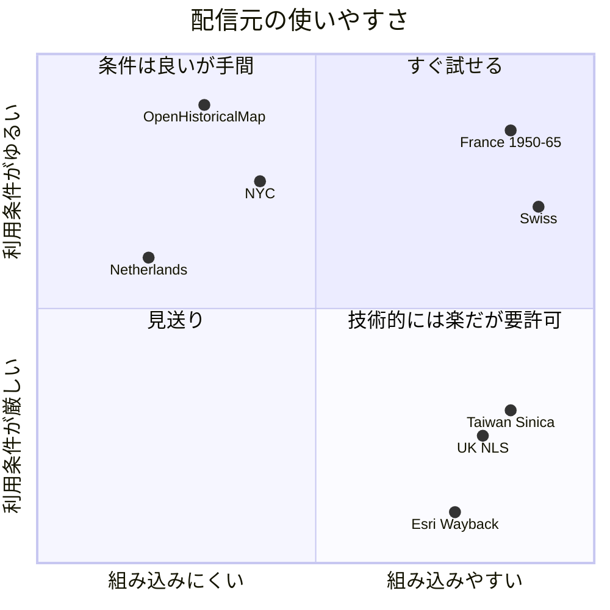
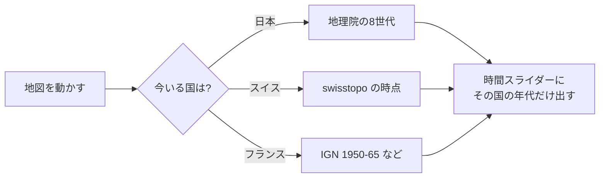

# 海外の古い空中写真・古地図 調査結果

- 調査日: 2026-10-27
- 目的: 地図探索モード（`/map/`）を海外に広げられるか、使える配信元を洗い出す
- 方法: 各配信元のタイルを実際に1枚取得し（HTTP ステータス・形式・CORS）、利用条件を一次資料で確認した
- 状態: **調査のみ。仕様・実装はまだ変えていない**

## 1. 結論

- **技術的には、今の地図にそのまま足せるものが複数ある。** スイス・フランス・台湾・イギリス（NLS）は、
  Leaflet の `L.tileLayer` にそのまま入る形（EPSG:3857 の `{z}/{x}/{y}`・キー不要・CORS 可）で配信されている
- **難しいのは利用条件。** 商用利用（今後の広告）まで認めると明記されているのはフランスだけ。
  スイスはほぼ可だが、1946年の写真に「有償」の記載があり要確認
- **最初の試作はスイスとフランスがよい。** 条件が最もはっきりしていて、年代も厚い
- 日本の歴史とつながる台湾・京城・満洲の地図は中央研究院（台湾）にまとまっているが、**非商用（CC BY-NC）**



## 2. 候補の一覧

「確認」は、タイルを実際に取得して中身（写真・地図）が写っていることを見たもの。

### 2.1 すぐ試せる

| 国 | レイヤ | 年代 | 範囲 | 確認 | キー | 利用条件 |
|---|---|---|---|---|---|---|
| スイス | 空中写真の時系列 `ch.swisstopo.swissimage-product` | **1926〜2025（約100時点）** | スイス・最大 z20 | ✅ | 不要 | ©swisstopo・商用可（注1） |
| スイス | 1946年の白黒写真 `ch.swisstopo.swissimage-product_1946` | 1946 | ほぼ全域・z17 | ✅ | 不要 | 同上（注1） |
| スイス | 地図の時間旅行 `ch.swisstopo.zeitreihen` | **1844〜2021（178時点）** | スイス・z18 | ✅ | 不要 | 同上 |
| フランス | 空中写真 `ORTHOIMAGERY.ORTHOPHOTOS.1950-1965` | 1950〜1965 | 本土と海外県・z18 | ✅ | 不要 | Licence Ouverte 2.0（**商用可**・出典表示） |
| フランス | 参謀本部図 `GEOGRAPHICALGRIDSYSTEMS.ETATMAJOR40` | 1820〜1866 | 本土・z15 | ✅（調査役） | 不要 | 規約（CGU）に従う。個別の確認はまだ |
| フランス | カッシーニ図 `BNF-IGNF_GEOGRAPHICALGRIDSYSTEMS.CASSINI` | 18世紀 | 本土・z14 | ✅（調査役） | 不要 | 未確認（注3） |

URL の形（`{year}` は時点の名前。例 `1946`、地図は `19461231`）:

```text
https://wmts.geo.admin.ch/1.0.0/ch.swisstopo.swissimage-product/default/{year}/3857/{z}/{x}/{y}.jpeg
https://wmts.geo.admin.ch/1.0.0/ch.swisstopo.swissimage-product_1946/default/1946/3857/{z}/{x}/{y}.jpeg
https://wmts.geo.admin.ch/1.0.0/ch.swisstopo.zeitreihen/default/{year}1231/3857/{z}/{x}/{y}.png
https://data.geopf.fr/wmts?SERVICE=WMTS&REQUEST=GetTile&VERSION=1.0.0&LAYER=ORTHOIMAGERY.ORTHOPHOTOS.1950-1965&STYLE=normal&TILEMATRIXSET=PM&FORMAT=image/png&TILEMATRIX={z}&TILECOL={x}&TILEROW={y}
```

### 2.2 技術的には楽だが、広告を出すなら許可が要る

| 国 | レイヤ | 年代 | 確認 | 利用条件 |
|---|---|---|---|---|
| 台湾（中央研究院） | 1945年 米軍空中写真（台北・台南・高雄・台中） | 1944〜1959 | ✅ | **CC BY-NC**。商用は個別の許諾 |
| 台湾（中央研究院） | 台湾堡図（1904・1921）、日本統治期の地形図、米軍の都市図 | 1904〜1945 | ✅ | 同上 |
| 台湾（中央研究院） | 京城（ソウル）1927/1933/1942、那覇・沖縄、大連など満洲90レイヤ | 1904〜1960 | ✅（調査役） | 同上 |
| イギリス（NLS） | 陸地測量部の地図（1843〜1960年代）、スコットランドの空中写真 1944〜50 | 1843〜1960s | ✅ | 非商用は可。**商用は NLS（geo@nls.uk）の許可が要り、通常は有料** |
| 全世界（Esri） | World Imagery Wayback | **2014年以降のみ** | ✅（調査役） | 商用不可（今の「最新（Esri）」と同じ条件） |

### 2.3 条件は良いが手間がかかる

| 国 | 内容 | 手間 |
|---|---|---|
| 台湾（国土測繪中心） | 1976年〜の写真図、2003年〜の正射写真。キー不要 | 日本統治期とつながらない。政府オープンデータ条項が付くかは未確認 |
| オランダ | Kadaster の地形図 1815〜2025 | **座標系が RD New（EPSG:28992）だけ**。今の地図に重ねられず、別の地図画面が要る。古い空中写真（PDOK）は2016年以降のみ |
| アメリカ | USGS の旧版地形図（1884〜・パブリックドメイン） | タイル配信が無い。GeoTIFF を落として自分でタイルにし、置く必要がある（容量が大きい） |
| ニューヨーク | 1924・1951年の空中写真（CC BY 4.0） | 配信元が移転中。**今のURLでは「Map Tile Service has moved」の画像が返る**（手元で確認）。移転先はキーが要るか未確認 |
| 全世界 | OpenHistoricalMap（CC0） | 写真ではなく、皆で描いた歴史地図（ベクター）。MapLibre 連携のプラグインが要る |

### 2.4 使えなかったもの

- 韓国（国土地理情報院・VWorld）: この環境からつながらず、確認できなかった
- NYPL Map Warper: 2021年に終了
- David Rumsey: CC BY-NC-SA、タイル配信は未確認
- ハワイ・サイパン・樺太: そのまま使えるタイルは見つからなかった

## 3. 注記

1. **スイス:** swisstopo の利用条件は「無料の地理データ・地理サービスは商用でも可、出典 ©swisstopo」。
   ただし SWISSIMAGE HIST 1946 の製品ページには「有償で提供」とあり、WMTS で表示するだけなら無料の範囲に入るのかは
   はっきり書かれていない。広告を出す前に swisstopo へ確認する。使いすぎると制限されることがある（目安は1日 約2万人まで）
   - https://www.swisstopo.admin.ch/en/terms-of-use-free-geodata-and-geoservices
   - https://www.geo.admin.ch/en/general-terms-of-use-fsdi
2. **フランス:** 1950-1965 のレイヤは公開の一覧（GetCapabilities）に載っておらず、タイルの取得だけができる。
   予告なく変わるかもしれないので、組み込むなら定期的に疎通を確かめる。それ以降の年代は名前を変えて試したが取れなかった
   - https://www.data.gouv.fr/datasets/bd-ortho-r-historique （Licence Ouverte 2.0）
   - https://cartes.gouv.fr/cgu/ （WMTS にリクエスト数の上限なし）
3. **カッシーニ図:** data.gouv.fr に Licence Ouverte のカッシーニ図はあるが、今回のレイヤと同じものかは未確認
4. **中央研究院:** 「申請不要で自由につないでよい」という発表資料と、「CC BY-NC、商用は別に許諾」という技術移転ページがある。
   広告を出さない今は出典（中央研究院人社中心GIS專題中心）を示せば使える。範囲外のタイルも **HTTP 200 で空白やHTMLが返る**ので、
   レイヤごとに `bounds` と `maxNativeZoom` を付けないと、欠けたタイルが並ぶ
   - https://ticket.apps.sinica.edu.tw/tech/20T-1100319
5. **NLS:** 公式の規約本文は CAPTCHA で読めず、OSM Wiki と MapTiler の案内からの判断
   - https://wiki.openstreetmap.org/wiki/National_Library_of_Scotland

## 4. 組み込むときに必要になること

今の地図は年代ごとのタイルを1つの配列に並べている（`map/index.html` の `esri_world`〜`ort_1928`）。
海外を足すと、次の3点を決める必要がある。



1. **年代の並べ方:** 国ごとに年代の区切りが違う（スイスは約100時点、フランスは1つ）。スライダーを国ごとに切り替えるか、共通の年代（1940年代・1950年代…）にまとめるか
2. **撮影範囲:** 今の `coverage_polygons` は日本の年代ごとの範囲。国の範囲も持たせる必要がある
3. **出典表示:** 配信元ごとに文言が違う。今のレイヤの `attribution` に入れる

## 5. 次にやること（提案）

1. スイスとフランスで試作ページを作り、日本と同じように重なるか（位置・色・ズーム）を画面で確かめる
2. 4章の「年代の並べ方」をユーザーと決め、仕様書に「海外対応」を足す
3. 広告を再開する可能性に備え、swisstopo（1946年の写真）への確認を検討する

---

## 6. 2回目の調査（2026-10-27）

1回目に無かった国を調べた。✅ は調査役がタイルを取得して中身を確認したもの。
**★ は私（親）も手元で取得し直して、写真・地図が写っていることを確かめたもの。**

WMS（地図を範囲指定で切り出して返す方式）は、Leaflet の `L.tileLayer.wms(url, {layers, format:'image/png', transparent:true})` でそのまま使える。
データの無い所は透明で返るので、地図の邪魔にならない（JPEG で頼むと白くなる配信元があるので、PNG＋透明を指定する）。

### 6.1 商用可（広告を出しても使える）

| 地域 | 中身 | 年代 | 方式 | 確認 | ライセンス |
|---|---|---|---|---|---|
| **ウィーン** | 空中写真 4世代＋2014〜2021年・最新（※1） | 1938・1956・1976・1992 | XYZ `https://mapsneu.wien.gv.at/wmts/lb1938/grau/google3857/{z}/{y}/{x}.jpeg`（**{y}/{x} の順**。昔は `grau`、2014年以降と最新 `lb` は `farbe`。市外は 404） | ★ | CC BY 4.0（Stadt Wien – data.wien.gv.at） |
| **ルール地方**（エッセン・ドルトムントなど） | 空中写真 | **1926**・1934・1952・1963・1969・1990・1998 | WMS `https://geodaten.metropoleruhr.de/lubi/lubi_1926`（layers=`lubi_1926`） | ★ | dl-de/by-2-0（Regionalverband Ruhr） |
| **スペイン全国** | 米軍撮影の空中写真、ほか 1973〜2024 | 1956〜57 ほか | WMS `https://www.ign.es/wms/pnoa-historico`（layers=`AMS_1956-1957`） | ★ | CC BY 4.0（scne.es） |
| **カタルーニャ**（バルセロナ） | 空中写真 | 1945〜46・1956〜57・1970〜77・1983〜毎年 | WMS `https://geoserveis.icgc.cat/servei/catalunya/orto-territorial/wms` | ★ | CC BY 4.0（ICGC） |
| **フランドル**（ベルギー北部） | 空中写真 | 1971（白黒）・1979〜90（カラー） | XYZ 相当（WMTS `GoogleMapsVL`） `https://geo.api.vlaanderen.be/OKZ/wmts?...&LAYER=okzpan71vl...` | ★ | 無償再利用ライセンス（Digitaal Vlaanderen） |
| **バイエルン** | 古地図（Uraufnahme 1808〜64 ほか） | 19世紀 | WMS `https://geoservices.bayern.de/od/wms/hist/v1/histkarten`（layers=`by_uraufnahme`） | ★ | CC BY 4.0 |
| NRW州（ケルンなど） | 空中写真（年ごとに範囲がまだら）、古地図 1836〜1945 | 1951〜2009、地図 1836〜 | WMS `https://www.wms.nrw.de/geobasis/wms_nw_hist_dop` ほか | ✅ | dl-de/by・dl-de/zero |
| ベルリン | 空中写真（解像度は粗め） | 1953 | WMS `https://gdi.berlin.de/services/wms/luftbild_1953_22` | ✅ | dl-de/zero（表示義務なし） |
| バスク州（ビルバオ） | 米軍撮影の空中写真 | 1945〜46・1956〜57・1977〜78 | WMS `https://www.geo.euskadi.eus/WMS_ORTOARGAZKIAK` | ✅ | 出典表示で利用可 |
| スペイン全国 | 古地図（市街図 1870〜1950、地形図の初版） | 1870〜 | WMS `https://www.ign.es/wms/minutas-cartograficas` ほか | ✅ | © IGN の表示で利用可 |

### 6.2 技術的には使えるが、利用条件が要確認・非商用

| 地域 | 中身 | 年代 | 確認 | 引っかかる点 |
|---|---|---|---|---|
| ブリュッセル | 空中写真（画質が非常によい） | 1930〜35・1953・1961〜1996 | ✅ | 1953 は CC BY。1930〜35 は権利の制限の記載あり |
| トロント | 空中写真 | 1939・1954・1965・1978 | ✅ | ライセンス未確認 |
| シドニー・ニューサウスウェールズ州 | 空中写真 | 1943・1951〜1975 | ✅ | 州の CC BY は「写真」を除外している可能性 |
| イタリア（エミリア＝ロマーニャ） | 空中写真（GAI） | 1954〜55 | ✅ | CC BY 3.0 の記載が古い（2006年） |
| イタリア全国・ロンバルディア | 空中写真 | 1954・1988〜89 | ✅ | 非商用扱いと考えるのが安全 |
| フランドル・ワロン | 古地図（フェラリス図 1777 など） | 18〜19世紀 | ✅ | 再利用は所有者に連絡・ロゴ表示が必要 |
| メクレンブルク＝フォアポンメルン州 | 空中写真 | 1953 | ✅ | タイルに著作権表示の文字が焼き込まれている。ライセンス未確認 |

### 6.3 そのままでは使えないもの

| 地域 | 理由 |
|---|---|
| ベルリン 1928・1938（高解像度） | 3857 で頼むと真っ白。自前でタイルに作り直す必要がある |
| チェコ 1950年代（全国） | 座標系が EPSG:5514 だけ。自前でタイルに作り直す必要がある |
| ポーランド | 調査環境から接続できず（国外からの接続を制限している可能性。日本の利用者から見えないおそれ） |
| デンマーク | 古い写真の公開配信なし。古地図は無料登録のトークンが要る（ブラウザに置くことになる） |
| スウェーデン・ノルウェー | 認証が必要、または登録済みの IP のみ |
| ニュージーランド | APIキーが必要（無期限のキーは問い合わせ） |
| フィンランド（ヘルシンキ） | 調査環境から接続できず未検証 |

※1（2026-10-27 追記・試作に入れるときに確認）: 最初の調査で「8世代（1961・1971・1981・1986 を含む）」と書いたが、
配信元の一覧（`https://mapsneu.wien.gv.at/wmts/1.0.0/WMTSCapabilities.xml`）にある昔の写真は **1938・1956・1976・1992 の4つだけ**だった。
1961・1971・1981・1986 は、少なくともこのタイル配信には無い。

同じときに確かめたこと（試作 `overseas-test.html` に入れた）:
- ルール地方は `lubi_1926`〜`lubi_1998` の7つの WMS がそれぞれ別の URL。範囲外は 200 で空の PNG。CORS は `*`
- ルール地方の「最新」には NRW 州の今の写真 `https://www.wms.nrw.de/geobasis/wms_nw_dop`（`nw_dop_rgb`・dl-de/zero-2-0）を使う
- スペインの `pnoa-historico` には `AMS_1956-1957`・`Interministerial_1973-1986`・`Nacional_1981-1986`・`SIGPAC`（1997〜2003）・`OLISTAT`・`PNOA2004`〜`PNOA2024` がある。
  1973〜86・1981〜86 はマドリード・バルセロナとも**写っていない**（334 バイトの空の PNG）。最新は `https://www.ign.es/wms-inspire/pnoa-ma`（`OI.OrthoimageCoverage`）

### 6.4 2回目のまとめ

- **商用可で年代も厚いのは、ウィーン（1938〜1992の4世代）・ルール地方（1926〜）・スペイン（全国1956〜）・カタルーニャ（1945〜）**
- WMS 方式は、今の試作のタイル方式（`L.tileLayer`）とは別の部品（`L.tileLayer.wms`）を使う。仕組みの追加は小さい

---

## 7. 3回目の確認（2026-10-27・試作に入れる前）

オーナーの指示で、6.1 の「商用可・すぐ足せるもの」と、2.1 の古地図を試作に入れた。入れる前に、各配信元の一覧（GetCapabilities）で
**レイヤ名・年代・利用条件**を確かめ、タイルを実際に取って中身・CORS を見た（2026-10-27）。

### 7.1 訂正

- **フランスの古地図（参謀本部図・カッシーニ図）の利用条件は、まだ確かめられていない。** 2.1 の表のとおり「規約に従う・未確認」のまま。
  オーナーへの説明で「商用可」の中に並べたのは誤りだった。IGN の公開データは 2021年からオープンライセンス、という二次情報はあるが、
  この2つのレイヤについての一次資料は見つからなかった。試作には入れ、**本実装・広告の前に IGN に確認する**
- **マドリードの市街図の URL:** 一覧の取得先は `wms/planos-historicos` だが、地図を返すのは `https://www.ign.es/wms/planos`（一覧の OnlineResource に書かれている）。
  `planos-historicos` に地図を頼むと 404

### 7.2 確かめた利用条件（各配信元の一覧に書かれているもの）

| 地域 | 中身 | 利用条件 |
|---|---|---|
| カタルーニャ | 空中写真 1945〜2025（`ortofoto_*`）、最新 `ortofoto_color_vigent` | ICGC（CC BY 4.0。一覧の条件は https://www.icgc.cat/condicions） |
| バスク州 | 空中写真 1945〜2025（`ORTO_*`）、最新 `ORTO_EGUNERATUENA_MAS_ACTUALIZADA` | 「Eusko Jaurlaritza / Gobierno Vasco. geoEuskadi」と表示すれば可 |
| フランドル | 1971（`okzpan71vl`）・1979〜90（`okzrgb79_90vl`）、最新 `OMWRGBMRVL/omwrgbmrvl` | 無料。Digitaal Vlaanderen の利用条件に従う |
| NRW州 | 空中写真 1951〜2024（1965 は無し）、古地図 Uraufnahme 1836〜50・Neuaufnahme 1891〜1912・TK25 1936〜45 | 古地図と 1970年以降の写真は dl-de/zero-2-0。**1951〜1969年の写真は dl-de/by-2-0 で「Geobasis NRW, Hansa Luftbild AG, Landesarchiv NRW, RW 0230」の表示が必要** |
| ベルリン | 1953（`c_luftbilder_1953_22_raster`）、最新 `truedop_2024` | dl-de/zero-2-0 |
| バイエルン | 古地図 Uraufnahme 1808〜53・Topographischer Atlas 1812〜67・Positionsblätter 1817〜72、最新の写真 `by_dop20c` | CC BY 4.0 |
| スイス | 地図の時間旅行 1844〜2021（178時点） | ©swisstopo（注1） |
| スペイン | Minutas（1870〜1950）、マドリードの市街図 11枚（1622〜1960） | 「© Instituto Geográfico Nacional de España」の表示（CC BY 4.0） |

### 7.3 気をつけること

- **バイエルンの Uraufnahme は、ズーム16以上でしか配信されない**（15以下は 334 バイトの空の PNG）。引いた画面では「この年の地図がありません」と出る
- **スペインの地形図 1:50,000 初版（`primera-edicion-mtn` の `MTN50`）は入れなかった。** マドリード・バルセロナ・トレド・サラゴサのどこでも、
  画面のタイルの 4〜12% で配信元が HTTP 500 を返し、地図に穴が開く（同じタイルで何度でも起きる）
- NRW の写真は年ごとに写る範囲がまだら（例: 1975年のエッセンは写っていない）
- NRW・バイエルンは CORS の許可元を、頼んだページのアドレスで返す（`file://` からは `null`）。どちらも試作で使える
- 範囲外の空タイル: ICGC・NRW・バイエルン・スペインは 334 バイト、バスクは 888 バイト、ベルリン 1953 は 1,670 バイト（ベルリンだけ「写真なし」の基準を 2,000 バイトにした）
