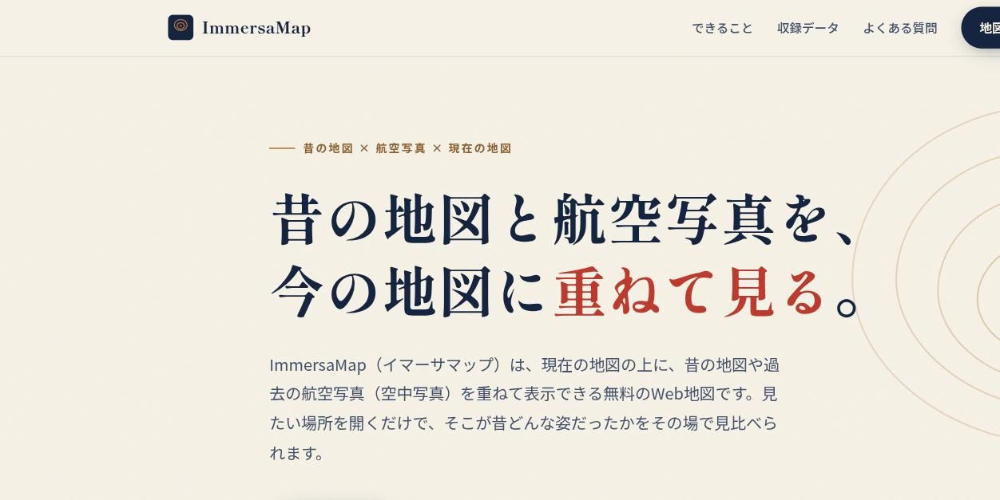
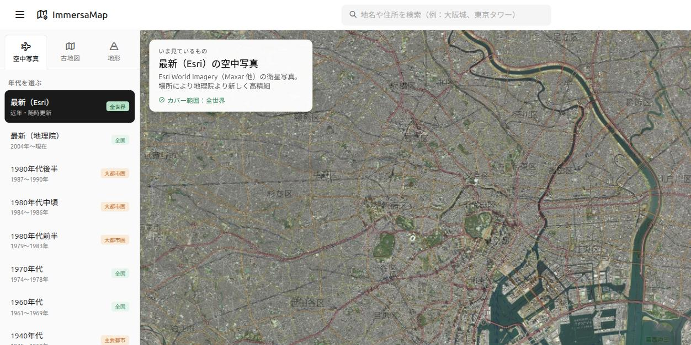

# 検索流入改善（キーワード整合・ページ差別化）確認結果

- 実施日：2026-09-07
- ブランチ：`feature/seo-copy-and-canonical`

## 背景

Google Search Console（2026-06-06〜2026-09-05 / 3か月）の実測値：

| 指標 | 値 |
|---|---|
| 合計クリック数 | 12 |
| 合計表示回数 | 166 |
| 平均CTR | 7.2% |
| 平均掲載順位 | 9.3 |

- **ページタブに出るURLは `https://immersamap.github.io/` の1本のみ**。`/map/` は3か月で一度も検索結果に露出していない。
- クエリタブは7語のみ（表示回数合計10）。残り156件はSearch Consoleの希少クエリ非表示によるもの。
- **指名検索（ImmersaMap／イマーサマップ）はゼロ**。流入は100%が一般語。

## 検出した問題

拾えているクエリと、サイト内の語の出現回数が一致していなかった。

| 検索されている語 | 修正前 index.html | 修正前 map/index.html |
|---|---:|---:|
| 昔の地図 | 0 | 0 |
| 航空写真 | 0 | 0 |
| 衛星写真 | 0 | 0 |
| 現在地 | 0 | 8 |
| 古地図 | 29 | 23 |
| 空中写真 | 27 | 19 |

サイトは「古地図」「空中写真」という専門用語のみで書かれており、一般ユーザーが使う
「昔の地図」「航空写真」「衛星写真」が1度も出現していなかった。

## 実施した修正

1. **index.html のコピー全面見直し**
   - title / description / OGP / JSON-LD（WebApplication・FAQPage）を、実クエリに沿った表現へ
   - h1「街のむかしを、地図の上で旅する。」→「昔の地図と航空写真を、今の地図に重ねて見る。」
   - 「地図上で旅をする」という当初構想の表現を、現状の機能（重ねて見比べる）に合わせて修正
   - FAQ本文と構造化データを同一内容に統一し、実クエリ由来の質問（現在地／無料）を追加
2. **map/index.html をトップページと差別化**
   - title / description / OGP を「操作するビューア本体」の位置づけに変更
   - `<h1 class="sr-only">` を追加（全画面アプリのため見出し要素が存在しなかった）
   - レイヤー説明に「衛星写真」「航空写真」を追記
   - ※ canonical は既に設置済みだったため変更なし
3. **sitemap.xml** に `/`・`/legal.html` を追加（従来は `/map/` の1件のみ）
4. **制作途中ページを非公開化**（`_config.yml` の exclude）
   - `ryoma/` `okunohosomichi/` `kawagoe.html` `kawagoe.jpg`

## 修正後のキーワード出現回数

| 語 | index.html | map/index.html |
|---|---:|---:|
| 昔の地図 | 25 | 4 |
| 航空写真 | 35 | 7 |
| 衛星写真 | 7 | 1 |
| 現在地 | 9 | 11 |
| 古地図 | 7 | 19 |
| 空中写真 | 10 | 15 |

## 表示確認（ローカル静的サーバ `python3 -m http.server 8080`）

| 対象 | 結果 |
|---|---|
| `/` トップページ描画 | ✅ 崩れなし（`20260907_seo_top_hero.jpg`） |
| `/map/` 地図ビューア描画 | ✅ 崩れなし。sr-only の h1 によるレイアウト影響なし（`20260907_seo_map_viewer.jpg`） |
| `/map/` コンソールエラー | ✅ なし |
| JSON-LD 構文 | ✅ `json.loads` でパース成功 |
| sitemap.xml 構文 | ✅ XMLパース成功 |
| _config.yml 構文 | ✅ YAMLパース成功（exclude 17件） |

## マージ後にやること

1. Search Console の「インデックス作成 > ページ」で `/map/` の除外理由を確認する
2. URL検査ツールから `/` と `/map/` のインデックス登録をリクエスト
3. サイトマップを再送信
4. 効果判定は最低4週間後（クエリ数・表示回数の推移を見る）
