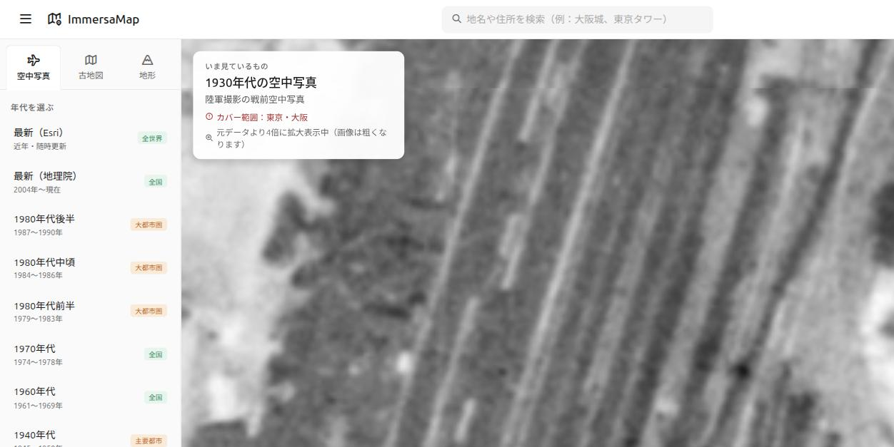
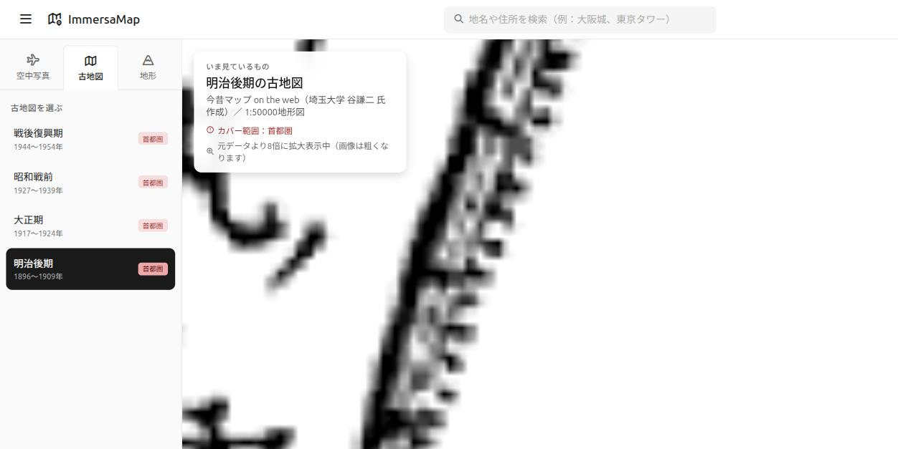

# 拡大時にオーバーレイが消える問題の修正 確認結果

- 実施日：2026-09-07
- ブランチ：`feature/upscale-tiles-beyond-native-zoom`

## 事象

空中写真や古地図を表示した状態でズームインしていくと、あるズームレベルを境に
オーバーレイが消え、背景の最新地図（OpenStreetMap）だけが表示される。

## 原因

各タイルレイヤーに `maxZoom`（＝配信元が実際にタイルを持っている上限）だけを指定しており、
`maxNativeZoom` を指定していなかった。

Leaflet では両者の役割が異なる。

| オプション | 意味 |
|---|---|
| `maxNativeZoom` | 配信元にタイルが存在する最大ズーム。**これを超えると既存タイルを引き伸ばして描画する** |
| `maxZoom` | そのレイヤーを表示する最大ズーム。**これを超えるとレイヤー自体が描画されなくなる** |

ベース地図（OSM）が `maxZoom: 19` なのに対し、地理院の空中写真は `maxZoom: 17`
だったため、z18以上でオーバーレイのみが消えていた。

なお今昔マップの4レイヤーだけは `maxNativeZoom:16, maxZoom:18` が指定済みで、
z17〜18では既に引き伸ばし表示になっていた（z19では消えていた）。

## 修正内容

1. `MAP_MAX_ZOOM = 19` を定数として定義し、ベース地図と全オーバーレイで共有
2. 各レイヤーの従来の `maxZoom` の値を `maxNativeZoom` に読み替え、`maxZoom` は `MAP_MAX_ZOOM` に統一

   | レイヤー | maxNativeZoom | 従来の表示上限 | 修正後 |
   |---|---:|---:|---:|
   | 最新（Esri） | 19 | 19 | 19 |
   | 最新（地理院） | 18 | 18 | 19 |
   | 1970〜1980年代（gazo1〜4） | 17 | 17 | 19 |
   | 1960年代（ort_old10） | 17 | 17 | 19 |
   | 1940年代（ort_USA10） | 17 | 17 | 19 |
   | 1930年代（ort_riku10） | 17 | 17 | 19 |
   | 1928年頃（ort_1928） | 18 | 18 | 19 |
   | 今昔マップ 4種 | 16 | 18 | 19 |
   | 色別標高図（relief） | 15 | 15 | 19 |
   | 陰影起伏図（hillshade） | 16 | 16 | 19 |

3. Supabase から読み込む古地図（`zoom_max`）も同様に `maxNativeZoom` として扱う
4. 「いま見ているもの」カードに、引き伸ばし中であることを示す注記を追加
   （例：「元データより4倍に拡大表示中（画像は粗くなります）」）。
   ネイティブズーム以下では非表示。

## 確認結果

| 対象 | 結果 |
|---|---|
| 1930年代 空中写真 @ z19（東京駅周辺） | ✅ 消えずに表示。注記「元データより4倍に拡大表示中」 |
| 明治後期 古地図 @ z19（同地点） | ✅ 消えずに表示。注記「元データより8倍に拡大表示中」 |
| 1930年代 空中写真 @ z17（ネイティブズーム） | ✅ 注記は非表示 |
| コンソールエラー | ✅ なし |

## 残る論点

古地図（今昔マップ、ネイティブ z16）を z19 まで拡大すると **8倍**となり、
線画のため写真より劣化が目立つ。上のスクリーンショットのとおり、等高線や
道路の線が滲む。

対応の選択肢：

- **A. 現状のまま**（どのレイヤーもz19まで消えない。古地図は8倍でかなり粗い）
- **B. 古地図表示中は地図側の最大ズームを z18 に制限**（4倍まで。消えることもなく、
  極端な劣化も避けられる）

現時点では A で実装している。
