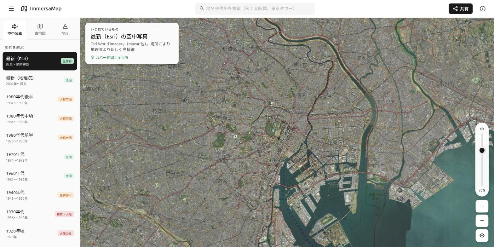

# ローカル管理セットアップ 動作確認結果

- **実施日:** 2026-09-07
- **目的:** GitHub のみで管理していた ImmersaMap をローカル（`/home/manabu/projects/immersamap`）でも管理できる状態にし、ドキュメント整理後もサイトが壊れていないことを確認する
- **確認方法:** `python3 -m http.server 8080` で静的配信し、各ページへアクセス

## 結果

| # | 確認項目 | 期待 | 結果 |
|---|---|---|---|
| 1 | `git clone`（SSH）できる | 成功 | ✅ 142コミット取得 |
| 2 | `git push` 権限がある | 成功 | ✅ `--dry-run` で確認 |
| 3 | `/` が表示される | HTTP 200 | ✅ |
| 4 | `/map/` が表示される | HTTP 200 | ✅ |
| 5 | `/okunohosomichi/` が表示される | HTTP 200 | ✅ |
| 6 | `/ryoma/` が表示される | HTTP 200 | ✅ |
| 7 | `/legal.html` が表示される | HTTP 200 | ✅ |
| 8 | 地図が実際に描画される（目視） | タイル・年代リストが表示 | ✅ 下記スクショ |
| 9 | ドキュメント移動でリンク切れが無い | 参照ゼロ | ✅ HTMLからの `*.md` 参照なし。`docs/CHANGELOG.md` の内部リンクは修正済み |

## スクリーンショット：`/map/`（ローカル）

空中写真レイヤー（最新Esri）が描画され、左ペインに年代リスト（1928年頃〜最新）と
カバー範囲バッジ（全世界／全国／大都市圏／東京・大阪／大阪のみ）が正しく出ている。

## 未実施・残課題

- Supabase 接続を伴う動作（地図データの読み込み、`maps` / `coverage_polygons`）は
  公開鍵での読み取りのため動作しているが、書き込み系は未検証
- E2Eテスト（Playwright）は未導入。`tests/e2e/` は今後整備する
- 🔴 RLSポリシーが実質全開放の件は未対応（`CLAUDE.md` の「セキュリティ」参照）
