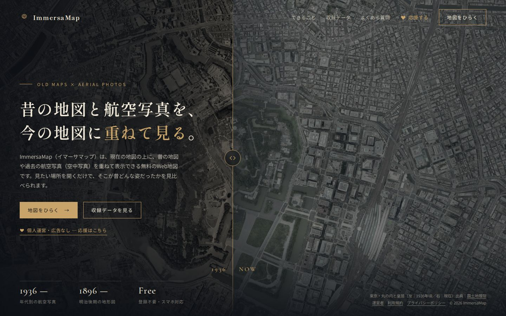
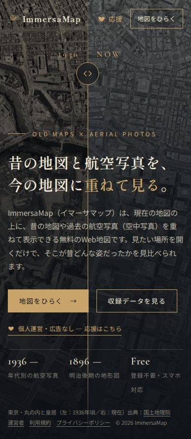
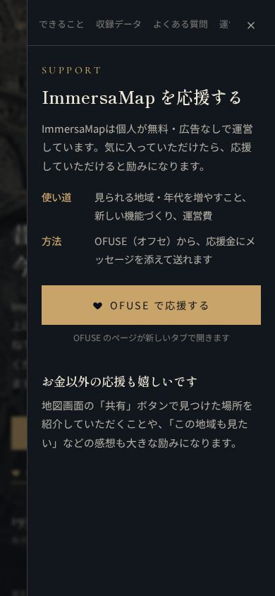
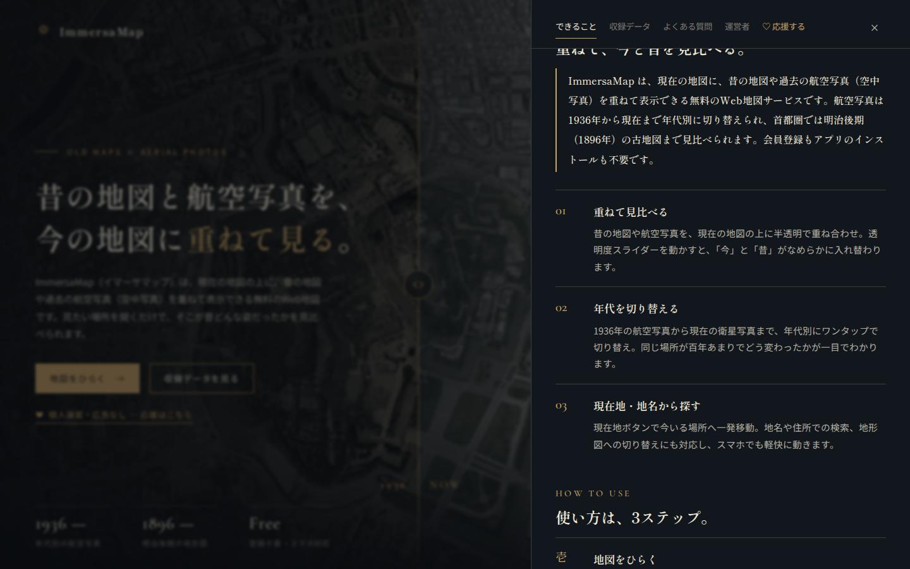
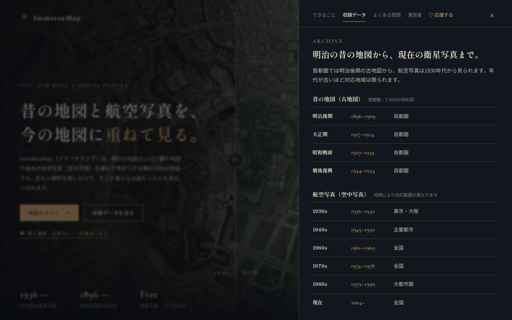
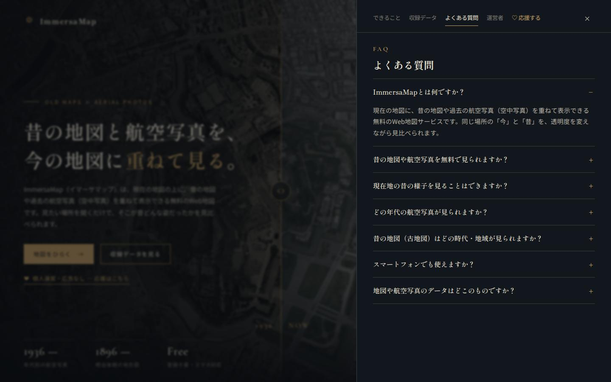

# トップページ刷新「ノワール」確認結果（2026-10-11）

実行：`python tests/e2e/top_page_check.py --shots docs/test_results/20261011_top_noir`（ローカルの index.html を直接開く）

**結果：79/79 PASS**

| 観点 | 内容 |
|---|---|
| PC 1画面 | 1920×1080／1440×900／1366×768／1280×720 で縦横スクロール無し。ロゴ・h1・地図ボタン・応援ボタン・数字・出典が画面内 |
| 境目 | ドラッグで 80% 付近へ動く、左キーで 4% 動く、写真2枚とも読み込み完了 |
| パネル | 5タブそれぞれ開き、他のタブは隠れる。Esc で閉じる |
| 旧アンカー | `#faq`→よくある質問、`#support`→応援、`#howto`→できること |
| SEO 移植 | h1 は1つ、canonical・OGP・robots、構造化データの質問7件＝画面の質問7件、収録データ・できることの文言、運営者名、出典 |
| 応援 | OFUSE リンクが新しいタブで開く設定 |
| スマホ 390px | 横スクロール無し、ヘッダー1行、応援ボタン表示、つまみが本文に重ならない、応援タブが開く、タブ1行 |
| JS エラー | 全サイズで無し |

## 画面写真

| PC | スマホ | スマホ（応援） |
|---|---|---|
|  |  |  |

パネル：  
