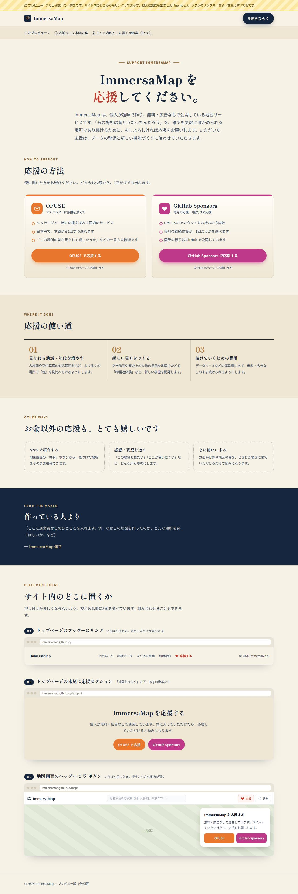
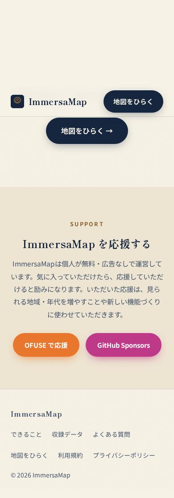

# 寄付（応援）ページ プレビュー 確認結果（2026-10-11）

対象: `support-preview/index.html` → https://immersamap.github.io/support-preview/

見た目確認用の下書き。サイト内リンク無し・`noindex,nofollow`・sitemap.xml 非掲載。
robots.txt にも書かない（書くと URL が公開されてしまうため）。OFUSE / GitHub Sponsors のリンクは仮（押しても移動しない）。

| 観点 | 結果 |
|---|---|
| PC幅 1280px で崩れなし | OK（`20261011_support_preview_pc.jpg`） |
| スマホ幅 390px で横スクロール無し | OK（scrollWidth = 390、`20261011_support_preview_sp.jpg`） |
| JS エラー無し | OK |
| 案C の♡ボタンで案内が閉じる（`[hidden]` が効く） | OK |
| 既存ページからリンクされていない | OK |

## 案B をトップページに組み込み（同日）

ユーザーが案B（トップページ末尾の応援セクション）を選んだ。`index.html` の「地図をひらく」の下・フッターの直前に `#support` として追加。
OFUSE / GitHub Sponsors のリンク先は未確定のため `#support`（その場から動かない）にしてある。**実URLに差し替えるまでマージしない。**

| 観点 | 結果 |
|---|---|
| PC 1280px／スマホ 390px で崩れなし・横スクロール無し | OK（`20261011_support_planB_pc.jpg` / `_sp.jpg`） |
| スクロールで表示される（reveal が効き opacity 1 になる） | OK |
| JS エラー無し | OK |

## 運営者名を「ImmersaMap」に統一（同日）

OFUSE の表示名とサイトの運営者名を「ImmersaMap」にそろえることをユーザーが決定（OFUSE ID も `immersamap` を推奨）。
- `index.html` の ABOUT に「運営者：ImmersaMap（個人運営）」「お問い合わせ：GitHub Issues」を追加
- `legal.html` 第1条に「運営者：ImmersaMap（個人運営）」を追加

| 観点 | 結果 |
|---|---|
| スマホ 390px で ABOUT が崩れない | OK（`20261011_about_operator_sp.jpg`） |
| JS エラー無し | OK |

## OFUSE のリンクを実URLに差し替え（同日）

OFUSE のプロフィールURLが `https://ofuse.me/immersamap` に決まった。
- 「OFUSE で応援」ボタンを実URLへ（新しいタブで開く）
- GitHub Sponsors は未登録のためボタンをコメントアウト（登録・審査後に有効化）
- 役目を終えた `support-preview/` を削除
- OFUSE のカバーアート `docs/ui/ofuse_cover_1000x150.png` を Pillow で作成（OGP と同じ等高線デザイン）

| 観点 | 結果 |
|---|---|
| `https://ofuse.me/immersamap` が開き、表示名 ImmersaMap が出る | OK（タイトル「ImmersaMap \| OFUSE (オフセ)」） |
| 応援セクションのボタンが OFUSE の1つだけ | OK |
| ボタンを押すと新しいタブで OFUSE のページが開く | OK |
| スマホ 390px で崩れ・横スクロール無し、JS エラー無し | OK（`20261011_support_ofuse_sp.jpg`） |

## 公開後の確認（PR #4 マージ後）

| 観点 | 結果 |
|---|---|
| マージから約40秒で公開サイトに反映 | OK |
| https://immersamap.github.io/ の応援欄に OFUSE ボタン1つ、押すと OFUSE が開く | OK（`20261011_support_live_sp.jpg`） |
| 利用規約に「運営者：ImmersaMap」 | OK |
| `/support-preview/` が消えている | OK（404） |
| スマホ 390px で横スクロール無し、JS エラー無し | OK |
