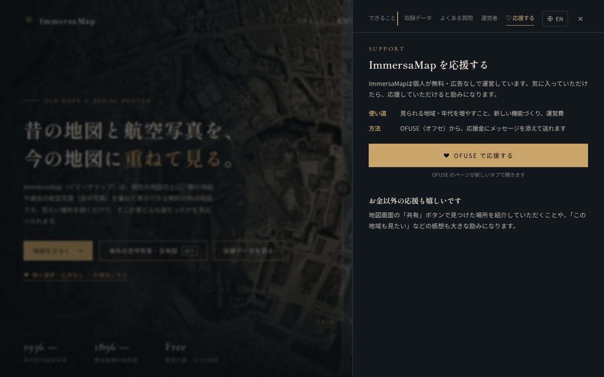
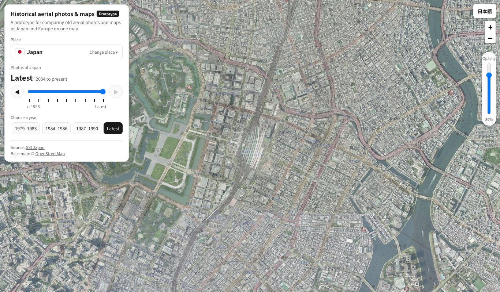
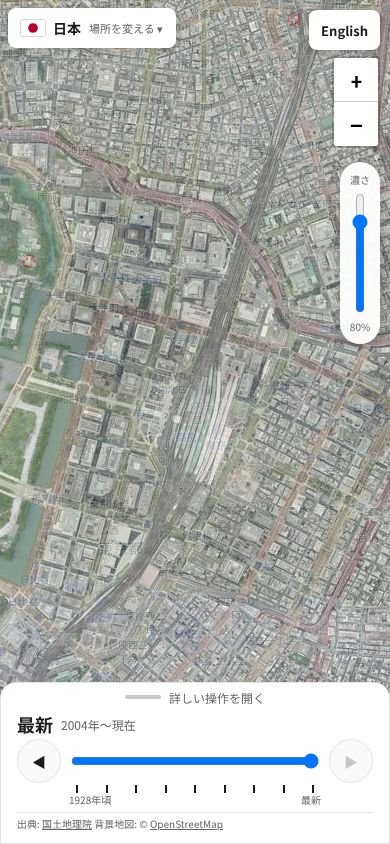
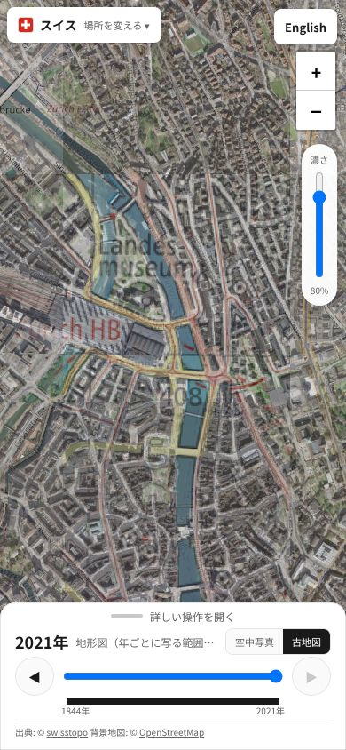

# 海外の空中写真・古地図と英語版の公開 確認結果（2026-10-27）

- 仕様・設計・レビュー: [`docs/spec/release_overseas_en.md`](../spec/release_overseas_en.md)（実装前 R1〜R6・実装後 P1〜P3）
- テスト設計: [`docs/test_design/release_overseas_en.md`](../test_design/release_overseas_en.md)
- 環境: Python 3.14.4・Playwright 1.64.1・Chromium（ヘッドレス）。`file://` で開き、地図の配信元へは実際に接続

## 結果

| テスト | 結果 |
|---|---|
| `tests/e2e/overseas_prototype_check.py`（`/overseas/`・`/en/overseas/`） | **197/197 PASS** |
| `tests/e2e/release_pages_check.py`（英語トップ・日本語トップに足したもの・転送・リンクの実在） | **50/50 PASS** |
| `tests/e2e/top_page_check.py`（今の日本語トップ） | **79/79 PASS** |

## 途中で見つけて直したこと

1. **テストの作りの誤り（3件。実装は変えていない）:**
   JavaScript を止めたページで「準備ができるまで待つ」を使っていた。転送ページを開いてから中身を読もうとして、転送で消えていた（2か所。HTML の文字から読むように直した）
2. **実装後レビューの P1〜P3:** 直して L5・L7 の確認を足した
3. **一時的な失敗:** フランス 1950〜65年（IGN）とカタルーニャ 1945〜46年（ICGC）で、それぞれ1回だけ 24〜28枚中 1枚が失敗。
   ブラウザで失敗したタイルを記録して4回流し直すと、どれも全部読めた。配信元の一時的なエラーと判断した
4. `tests/e2e/top_test_check.py` は消した（試作トップは転送ページになったため。英語トップは `release_pages_check.py` で確かめる）

## 画面写真

| 場面 | 写真 |
|---|---|
| 日本語トップ（入口と English） |  |
| 英語トップ |  |
| 英語トップの FAQ |  |
| スマホ・日本語トップのパネル |  |
| スマホ・英語トップのパネル |  |
| 英語の海外のページ |  |
| スマホ・海外のページ |  |
| スマホ・チューリッヒの古地図 |  |

## 公開後の確認（PR #23 マージ後）

| テスト（公開サイト） | 結果 |
|---|---|
| `overseas_prototype_check.py https://immersamap.github.io/` | **197/197 PASS** |
| `release_pages_check.py https://immersamap.github.io/` | 1回目 48/50 → テストを直して **50/50 PASS** |
| `top_page_check.py https://immersamap.github.io/` | **79/79 PASS** |

- 1回目の 48/50 は**テストの誤り**。転送そのものは正しく、転送先の海外のページが開いたあとに見ている場所を `#` に書くため、
  `#` まで含めて比べていた T1 が落ちた（`file://` では転送先がフォルダの一覧になり JS が動かないので、手元では起きなかった）。期待に `#` が無いときは `#` より前で比べるよう直した
- 新しい URL（`/en/`・`/overseas/`・`/en/overseas/`）・`sitemap.xml` は 200。試作のアドレスは新しい URL へ転送される
