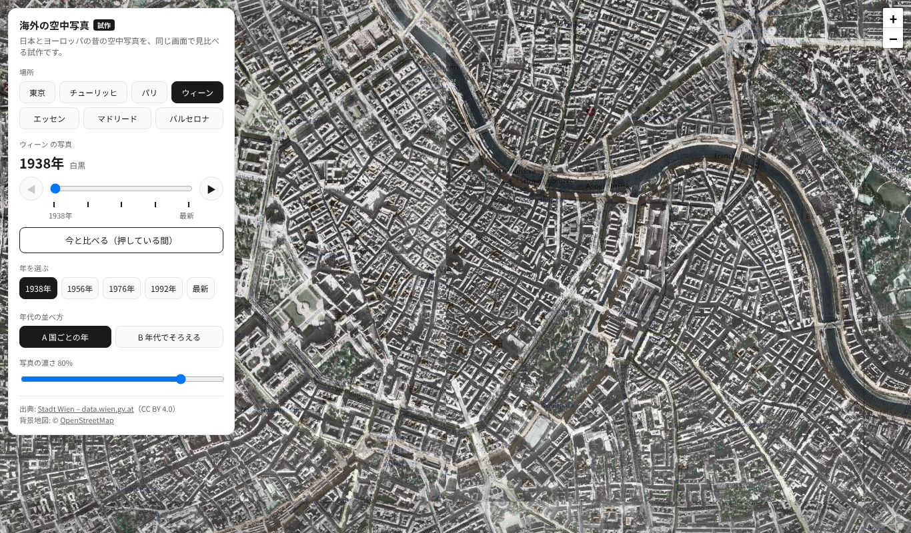
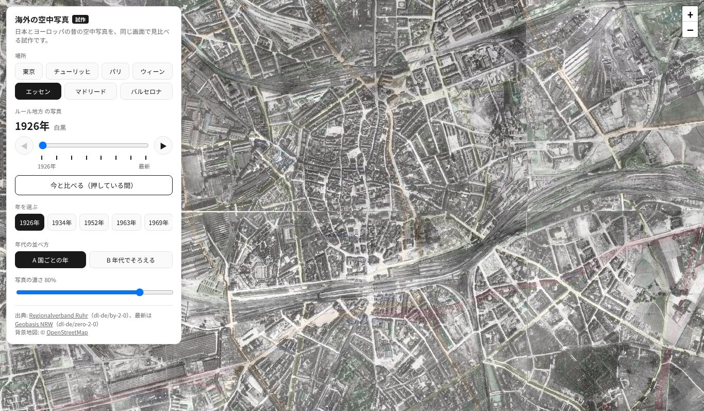
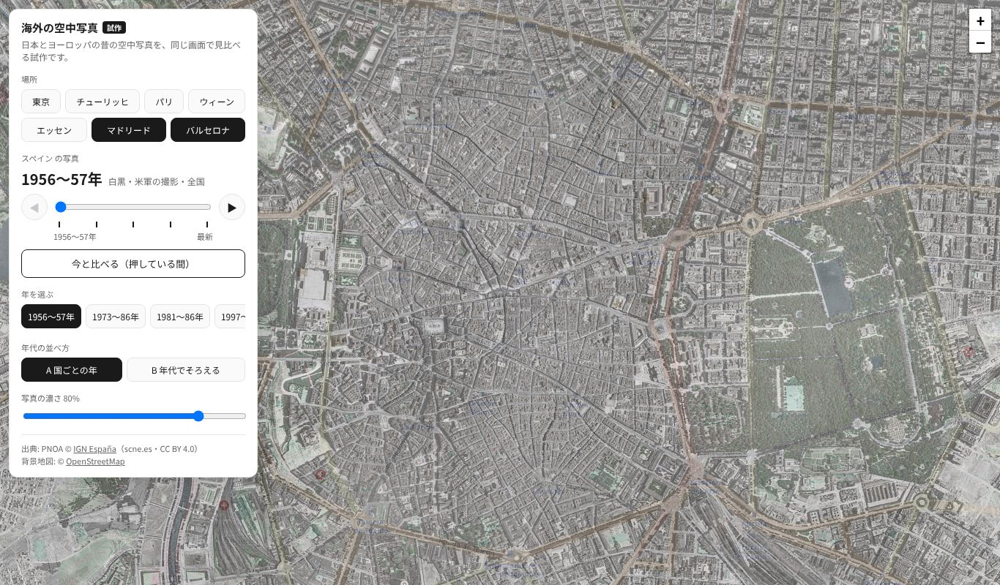
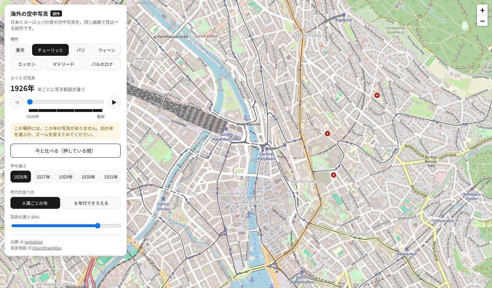
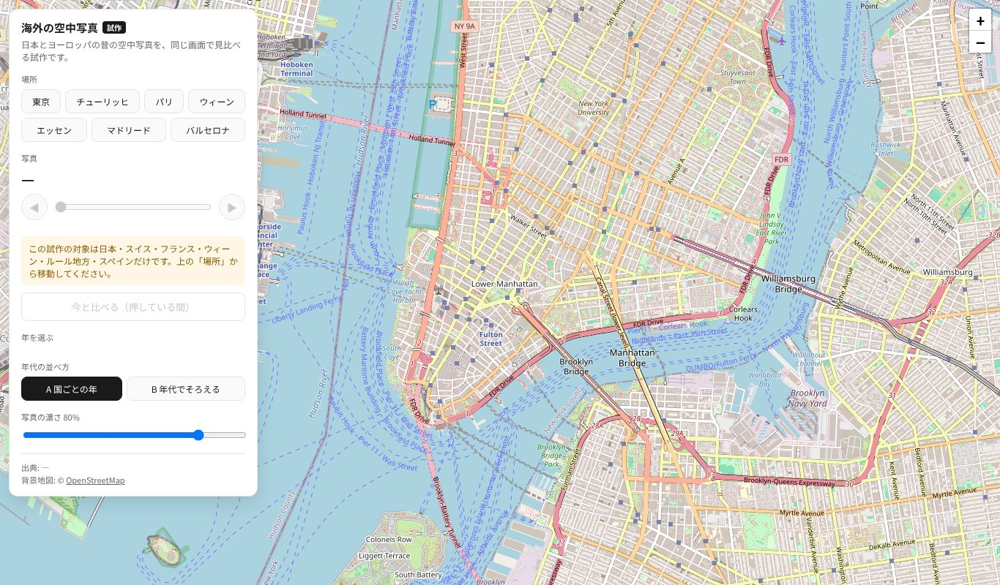

# 海外の空中写真 試作 2回目 確認結果（2026-10-27）

- 対象: `overseas-test.html`（ウィーン・ルール地方・スペインの追加と、スマホの操作性の改善）
- テスト設計: [`docs/test_design/overseas_prototype.md`](../test_design/overseas_prototype.md)（N8・N9・M1〜M4・E5・E6 を追加）
- UI レビュー: [`docs/ui/overseas_prototype_mobile_review.md`](../ui/overseas_prototype_mobile_review.md)
- 実行: `.venv/bin/python tests/e2e/overseas_prototype_check.py --shots docs/test_results/20261027_overseas_r2`
- 環境: Python 3.14.4・Playwright 1.64.1・Chromium（ヘッドレス）。`file://` で開き、配信元へ実際に接続

## 結果: 76/76 PASS

| 区分 | 件数 | 結果 |
|---|---|---|
| 正常系 N1〜N9（全体のエラー確認を含む） | 48 | すべて PASS |
| スマホ M1〜M4 | 9 | すべて PASS |
| 異常系 E1〜E6 | 19 | すべて PASS（E2・E3 は注入が効いたことも確認） |
| 既存のトップページ（P2） | 79 | すべて PASS（`tests/e2e/top_page_check.py`） |

- P1: 既存の HTML・`sitemap.xml` は変えていない（変えたのは `overseas-test.html`・テスト・ドキュメントだけ）

## 途中で見つけて直したこと

1. **ウィーンの年代の誤り（調査の訂正）:** 調査では「8世代」としていたが、配信元の一覧にある昔の写真は 1938・1956・1976・1992 の4つだけだった。
   `docs/spec/overseas_sources_research.md` を訂正した
2. **前の層のタイルが数えに混ざる:** 前の写真を読み終わりまで残すようにしたため、前の層のタイルの読み込みが今の層の数に入りうる。
   数えるのを表示中の層だけにした
3. **読みかけの画面写真:** 最初のタイルが来た時点で撮っていたため、遅い WMS（ルール地方）で真ん中が欠けた写真になった。
   表示中のタイルが全部そろうまで待つようにした（テストの待ち方の修正。判定の基準は変えていない）
4. **テストの想定違い（2件）:** なぞる操作の最後の年は 1947年だった（1946年と書いていた）。場所の行とズームのボタンは左右に並ぶので、
   重なりは横方向で見るのが正しい。どちらも実装ではなくテストを直した
5. **一時的な失敗:** 1回、フランス 1950〜65年でタイル 24 枚中 1 枚が失敗して N4 が FAIL になった。再実行で 24/24 読めて PASS。
   配信元（IGN）の一時的なエラーと判断した。実装もテストも変えていない

## 画面写真

| 場面 | 写真 |
|---|---|
| ウィーン 1938年 |  |
| エッセン（ルール地方）1926年 |  |
| マドリード 1956〜57年 |  |
| スマホ縦・畳んだ状態 |  |
| スマホ縦・開いた状態 |  |
| 小さいスマホ・開いた状態 |  |
| スマホ横 |  |
| チューリッヒ 1926年（写真なしのお知らせ） |  |
| 対象外（ニューヨーク） |  |

## 公開後の確認（PR #13 マージ後）

- P3: `tests/e2e/overseas_prototype_check.py https://immersamap.github.io/overseas-test.html` → **76/76 PASS**
- P4: 公開中のトップ・`/map/`・`sitemap.xml` に `overseas` の文字は 0 件。ページに `noindex` あり
