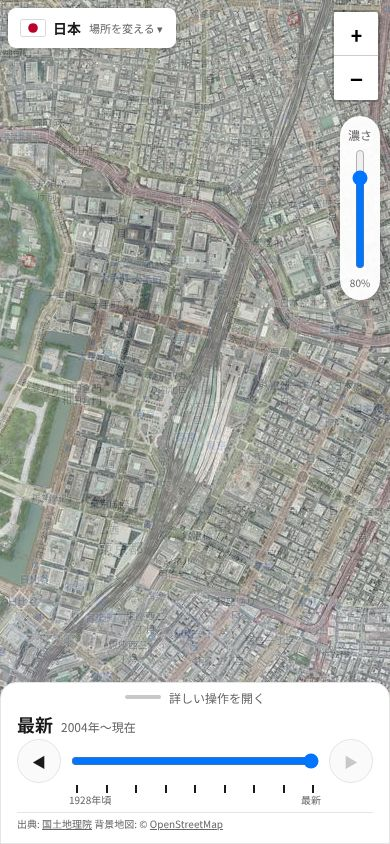
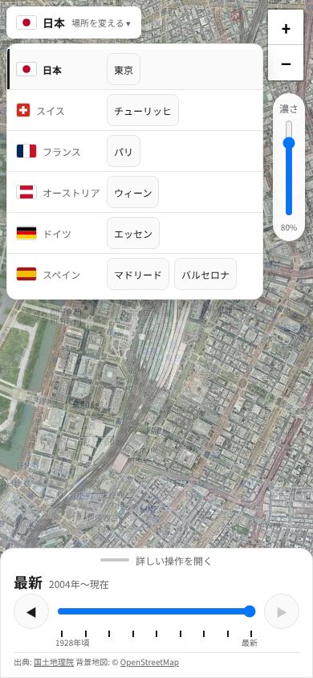
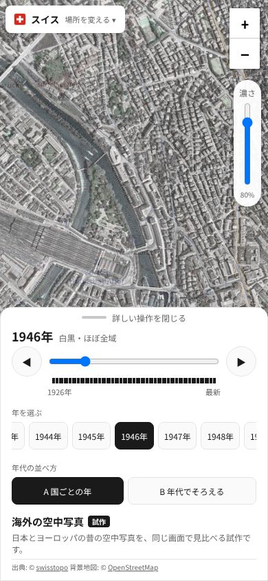
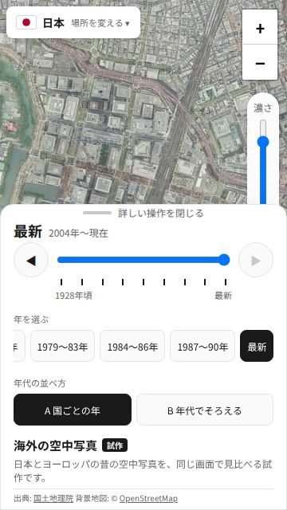
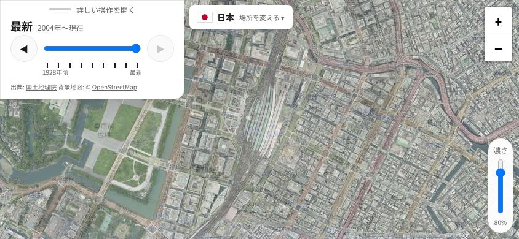

# 海外の空中写真 試作 3回目 確認結果（2026-10-27）

- 対象: `overseas-test.html`（オーナーの意見を受けた画面の変更: 小さいシート・縦の濃さスライダー・国旗付きの場所の一覧）
- テスト設計: [`docs/test_design/overseas_prototype.md`](../test_design/overseas_prototype.md)（M3・M5・M6・E6 を変更・追加。「今と比べる」の確認は削除）
- UI レビュー: [`docs/ui/overseas_prototype_mobile_review.md`](../ui/overseas_prototype_mobile_review.md) の「3回目」
- 実行: `.venv/bin/python tests/e2e/overseas_prototype_check.py --shots docs/test_results/20261027_overseas_r3`

## 結果: 81/81 PASS

| 区分 | 件数 | 結果 |
|---|---|---|
| 正常系 N1〜N9（全体のエラー確認を含む） | 46 | すべて PASS |
| スマホ M1〜M6 | 15 | すべて PASS |
| 異常系 E1〜E6 | 20 | すべて PASS |
| 既存のトップページ（P2） | 79 | すべて PASS |

- P1: 既存の HTML・`sitemap.xml` は変えていない（変えたのは `overseas-test.html`・テスト・ドキュメントだけ）

## 途中で見つけて直したこと

1. **テストの触る位置の誤り:** 「一覧の外を触ると閉じる」で、触った位置（y=400）が一覧（y=54〜474）の中だった。一覧のすぐ下を触るようにテストを直した。
   あわせて、外側の判定を触れた瞬間（`pointerdown`）にした（地図をドラッグし始めたときにも閉じる）
2. **両端の年を戻したらシートが伸びた:** 157px → 170px になり、地図が 8割を切った（M1 が FAIL）。
   シートの上のつまみ（32→28px）と年の行の高さを詰めて 162px にした（実装を直した。基準の 8割は変えていない）
3. **一覧でスペインの2都市が縦に折れた:** 一覧の幅を 280px → 320px にした

## 画面写真

| 場面 | 写真 |
|---|---|
| スマホ縦・畳んだ状態 |  |
| 場所の一覧 |  |
| スマホ縦・開いた状態 |  |
| 小さいスマホ・開いた状態 |  |
| スマホ横 |  |
