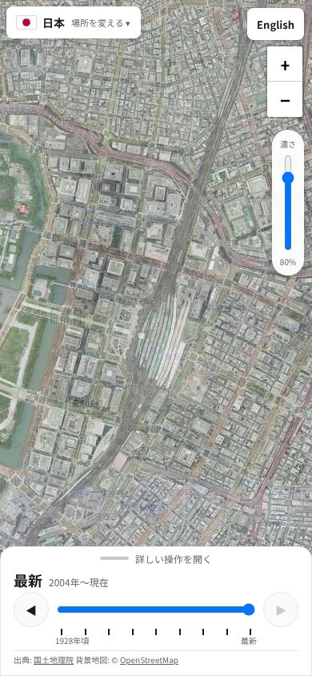
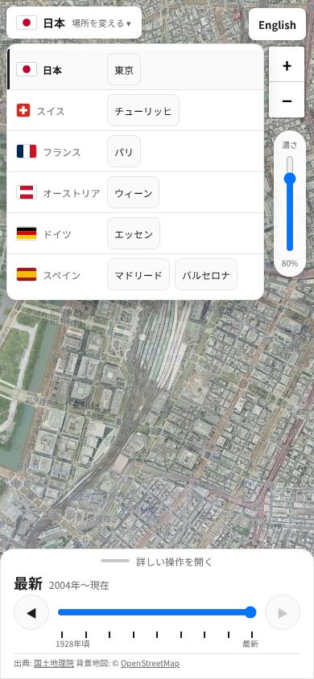

# 海外の空中写真 試作 4回目 確認結果（2026-10-27）

- 対象: `overseas-test.html`（年の並べ方を1つにする・日本語／英語・UIレビュー4回目の R1〜R3）
- テスト設計: [`docs/test_design/overseas_prototype.md`](../test_design/overseas_prototype.md)（N5 を差し替え、N10・M7・L1〜L6 を追加）
- UI レビュー: [`docs/ui/overseas_prototype_mobile_review.md`](../ui/overseas_prototype_mobile_review.md) の4回目
- 実行: `.venv/bin/python tests/e2e/overseas_prototype_check.py --shots docs/test_results/20261027_overseas_r4`
- 環境: Python 3.14.4・Playwright 1.64.1・Chromium（ヘッドレス）。`file://` で開き、配信元へ実際に接続。言葉の指定が無いテストは日本語のブラウザ（`ja-JP`）として開く

## 結果: 121/121 PASS

| 区分 | 件数 | 結果 |
|---|---|---|
| 正常系 N1〜N10（全体のエラー確認を含む） | 61 | すべて PASS |
| スマホ M1〜M7 | 16 | すべて PASS |
| 異常系 E1〜E6 | 22 | すべて PASS（E2・E3 は注入が効いたことも確認） |
| 言葉 L1〜L6（全体のエラー確認を含む） | 22 | すべて PASS |
| 既存のトップページ（P2） | 79 | すべて PASS（`tests/e2e/top_page_check.py`） |

- P1: 既存の HTML・`sitemap.xml` は変えていない（変えたのは `overseas-test.html`・テスト・ドキュメントだけ）

## 途中で見つけて直したこと

1. **360px の日本語で、場所のボタンが言葉のボタンにかかる:** 「オーストリア・ウィーン 場所を変える ▾」が右端 301px、言葉のボタンが 279px から。
   テストが 390px しか見ていなかった。幅に上限を付け、国名が切れるときだけ「場所を変える」を隠すようにし、L6 に 360px・日本語を足した
2. **英語の「Opacity」が濃さの枠からはみ出す:** 画面写真で発見。文字を 10px にし、L1 にはみ出しの確認を足した
3. **UIレビュー4回目の R1〜R3:** 国を行き来すると年がずれる・四角い枠で隣の国がフランス／スイスになる・小さい画面で開いたシートが濃さにかぶる。
   直して、N5（行き来・対象外を経る）・N10（17都市）・E5（かぶらない・シートの中で送れる）を足した
4. **一時的な失敗:** 1回、フランス 1950〜65年でタイル 24 枚中 1 枚が失敗して N4 が FAIL。再実行で PASS。2回目と同じ配信元（IGN）の一時的なエラーと判断した。実装もテストも変えていない

## 画面写真

| 場面 | 写真 |
|---|---|
| PC・英語（東京） |  |
| スマホ縦・英語（ウィーン） |  |
| スマホ縦・日本語・畳んだ状態 |  |
| 場所の一覧 |  |
| スマホ縦・開いた状態（チューリッヒ 1946年） |  |
| 小さいスマホ・開いた状態 |  |
| スマホ横 |  |

## 公開後の確認（PR #17 マージ後）

- P3: `tests/e2e/overseas_prototype_check.py https://immersamap.github.io/overseas-test.html` → **121/121 PASS**
  （続けて流した別の1回は 120/121。どの確認が落ちたかは記録できていない。続く3回目は 121/121。配信元のタイルの一時的な失敗と見ているが、確かめてはいない）
- P4: 公開中のトップ・`/map/`・`sitemap.xml` に `overseas` の文字は 0 件。ページに `noindex` あり
