# 海外の空中写真 試作 5回目 確認結果（2026-10-27）

- 対象: `overseas-test.html`（地域6つと古地図を足した・空中写真と古地図の切り替え）
- 配信元の確認: [`docs/spec/overseas_sources_research.md`](../spec/overseas_sources_research.md) の 7章
- 設計: [`docs/design/overseas_prototype.md`](../design/overseas_prototype.md) の 7章
- テスト設計: [`docs/test_design/overseas_prototype.md`](../test_design/overseas_prototype.md)（N11・N12・M8 を追加、N8・N10 を更新）
- UI レビュー: [`docs/ui/overseas_prototype_mobile_review.md`](../ui/overseas_prototype_mobile_review.md) の5回目
- 実行: `.venv/bin/python tests/e2e/overseas_prototype_check.py --shots docs/test_results/20261027_overseas_r5`

## 結果: 184/184 PASS

- 今のトップ（`tests/e2e/top_page_check.py`）79/79 PASS、試作トップ（`tests/e2e/top_test_check.py`）65/65 PASS
- 既存の HTML・`sitemap.xml` は変えていない

## 途中で見つけて直したこと

1. **スペインの地形図 1:50,000 初版を外した:** どの場所でも 4〜12% のタイルで配信元が HTTP 500 を返し、穴が開く（同じタイルで再現）。手元から1枚ずつ取ると成功するのに、地図の画面では毎回失敗するので、ブラウザで失敗した URL を記録して確かめた
2. **マドリードの市街図の URL:** 調査の URL（`planos-historicos`）では 404。一覧に書かれた `planos` が正しい
3. **スマホの畳んだシート:** 切り替えを足すと 170px（地図 79.9%）になったので、切り替えを高さ 28px にして 166px に戻した（M8 を追加）
4. **UIレビュー5回目の S1・S2:** ルール地方の四角がデュッセルドルフ等を取り込む／細かい古地図を引いた画面で「無い」と出る。直してテストを足した
5. **テストの想定の誤り（2件、どちらも実装は正しい）:** ルール地方の年の数（8 → 76。NRW州の写真を足したため）。日本で出る年は、前の確認で選んだ年に近いもの（1952年を選んだあとなので 1945〜50年）で、「最新」と決めつけていた
6. **一時的な失敗:** 1回、参謀本部図で 24枚中 1枚が失敗。再実行で 184/184。配信元（IGN）の一時的なエラーと判断した
7. **テストが途中で止まる:** 1回、NRW州の写真（ケルン 1951年）が 30秒たっても1枚も返らず、待ちの時間切れでテスト全体が止まった
   （同じ回にフランス 1950〜65年でも 24枚中 1枚が失敗）。NRW州の配信は1枚に約2秒かかる（手元で3回測って 1.7〜2.0秒）。
   時間切れをその確認の FAIL として記録し、残りの確認を続けるようにテストを直した（判定の基準は変えていない）。再実行で 184/184 PASS

## 画面写真

| 場面 | 写真 |
|---|---|
| バルセロナ 1945〜46年（カタルーニャ） | 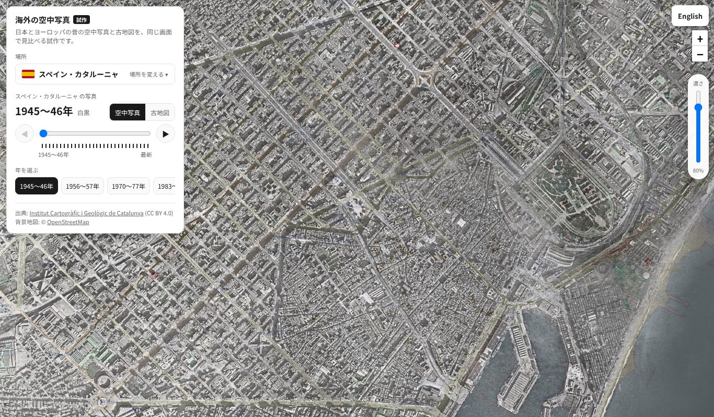 |
| ビルバオ 1945〜46年（バスク州） | 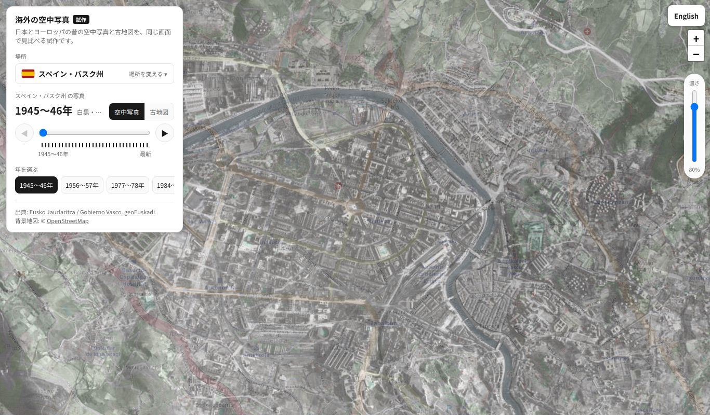 |
| アントワープ 1971年（フランドル） | 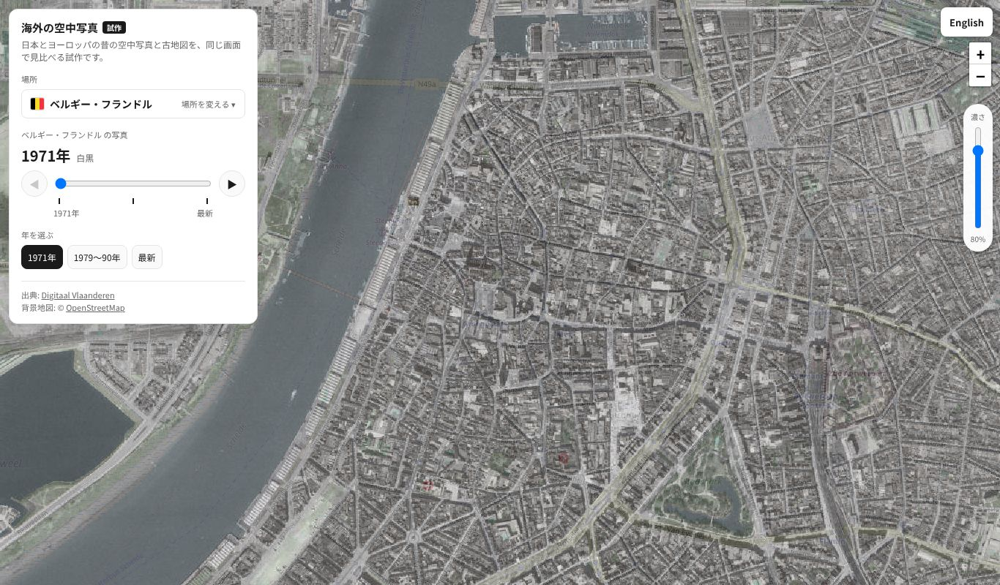 |
| ケルン 1951年（NRW州） | 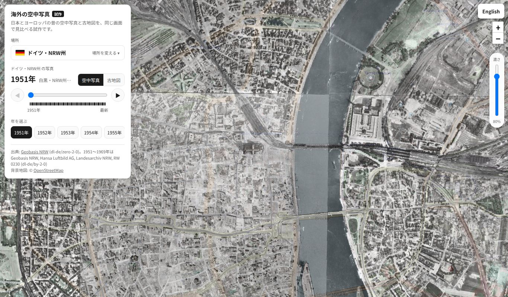 |
| ベルリン 1953年 | 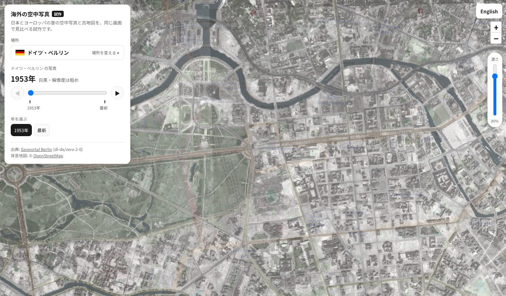 |
| ミュンヘン 最新 | 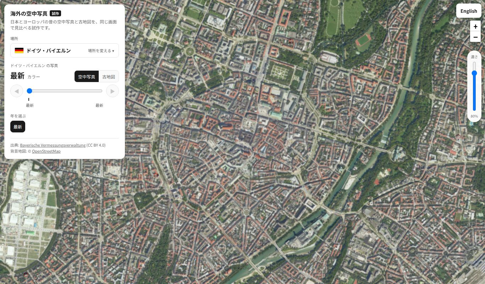 |
| チューリッヒ 1900年の地図 | 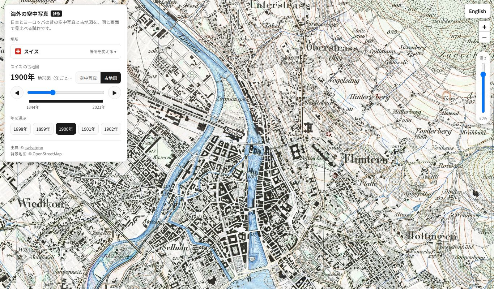 |
| パリ カッシーニ図 | 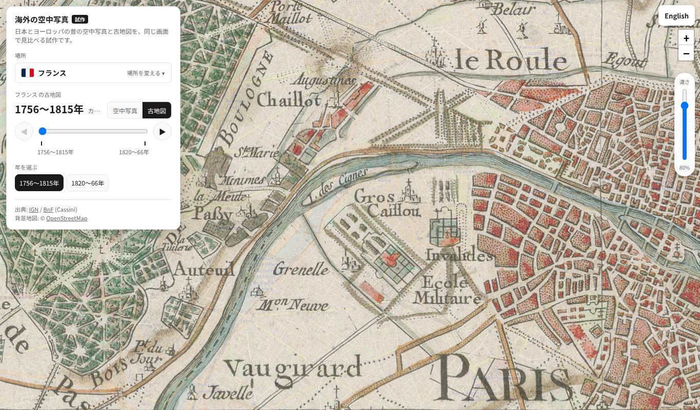 |
| パリ 参謀本部図 |  |
| ケルン 1891〜1912年の地図 | 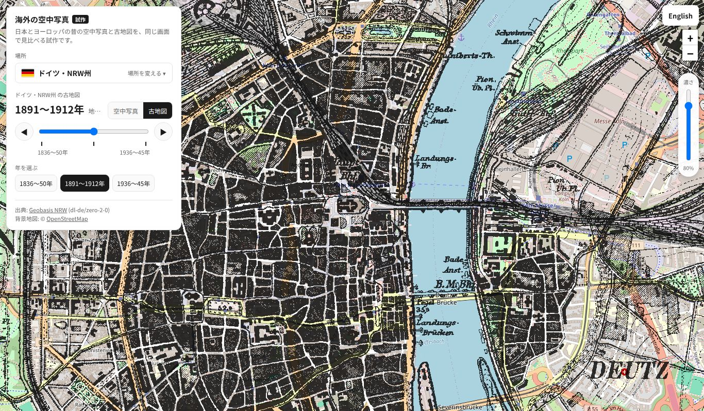 |
| ミュンヘン 1817〜72年の地図 | 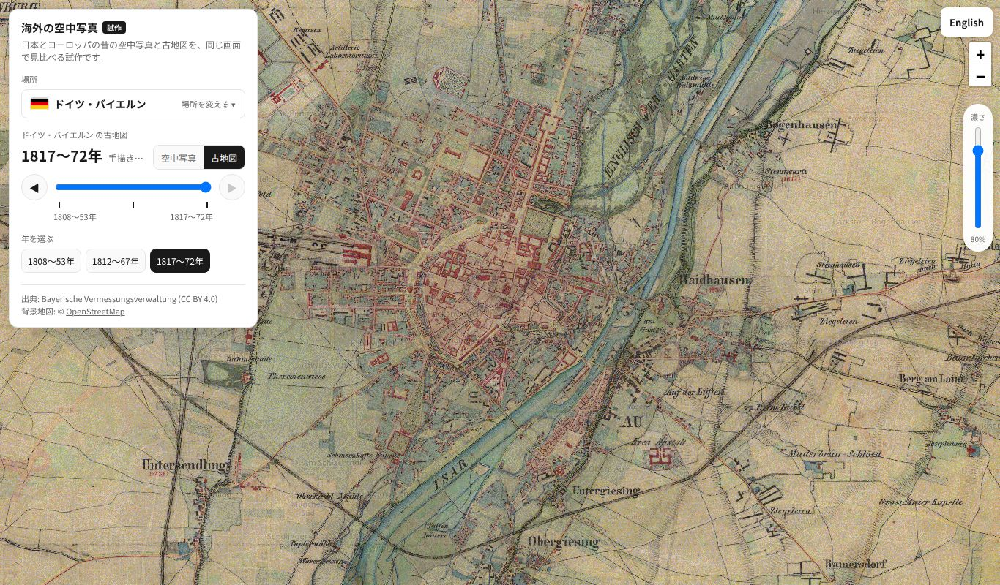 |
| マドリード 1656年の市街図 |  |
| スペインの Minutas | 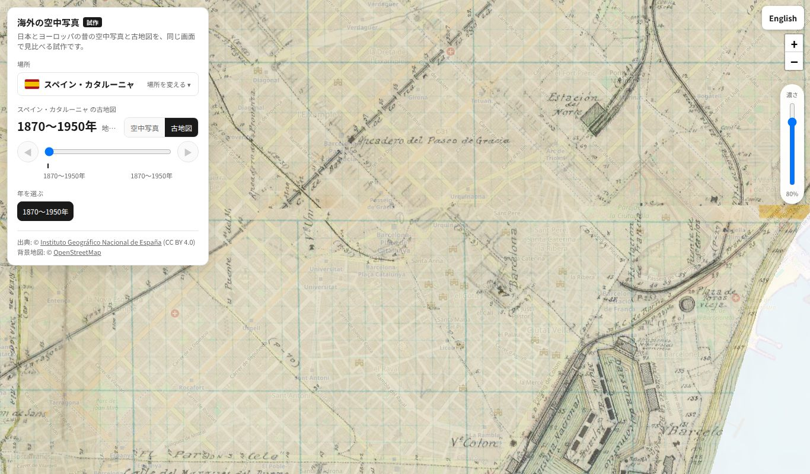 |
| スマホ・チューリッヒの古地図 |  |
| スマホ・場所の一覧 |  |

## 公開後の確認（PR #21 マージ後）

- P3: `tests/e2e/overseas_prototype_check.py https://immersamap.github.io/overseas-test.html`
  - 1回目 183/184（フランドル 1971年で 24枚中 1枚が失敗）、2回目 **184/184 PASS**
  - どの回も、どこか1つの配信元で1枚だけ失敗することがある（IGN・フランドル）。一部の失敗ではお知らせを出さない作りなので、画面は崩れない
- 試作トップ `tests/e2e/top_test_check.py https://immersamap.github.io/top-test.html` → 65/65 PASS
- P4: 公開中のトップ・`/map/`・`sitemap.xml` に `overseas` の文字は 0 件
