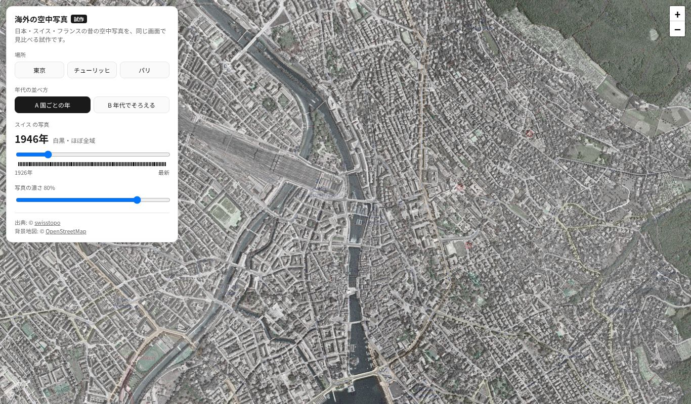
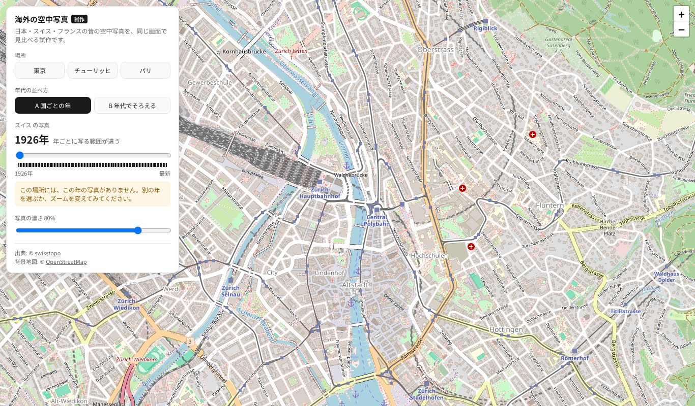
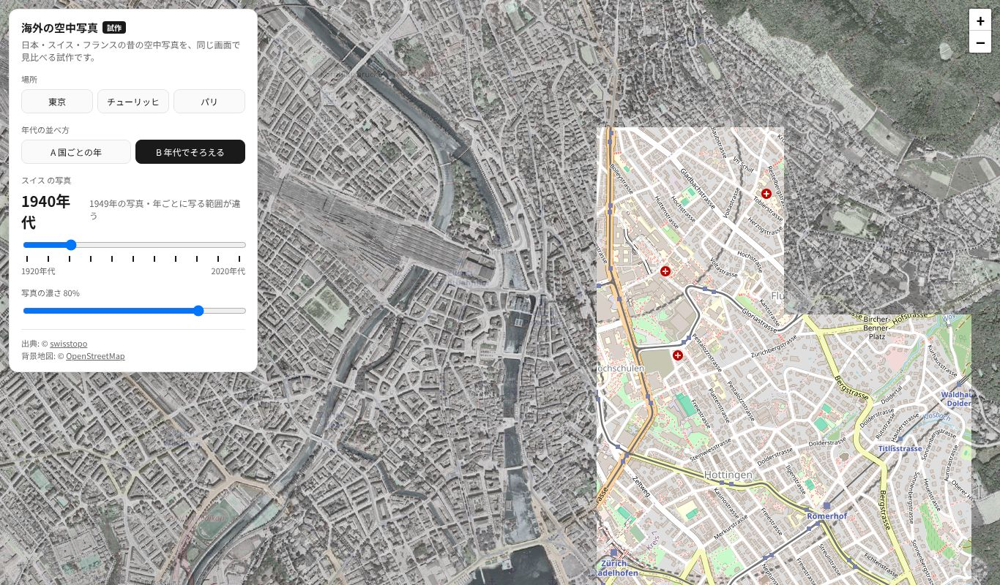
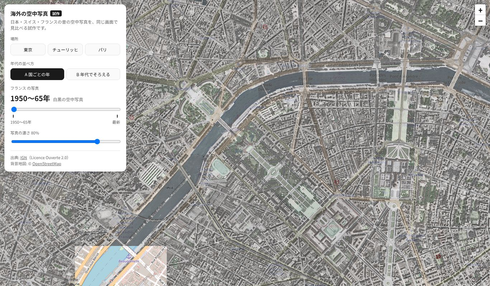
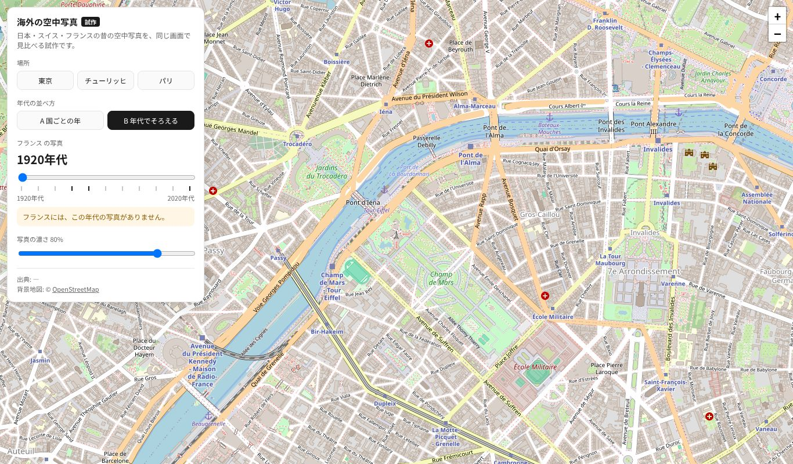
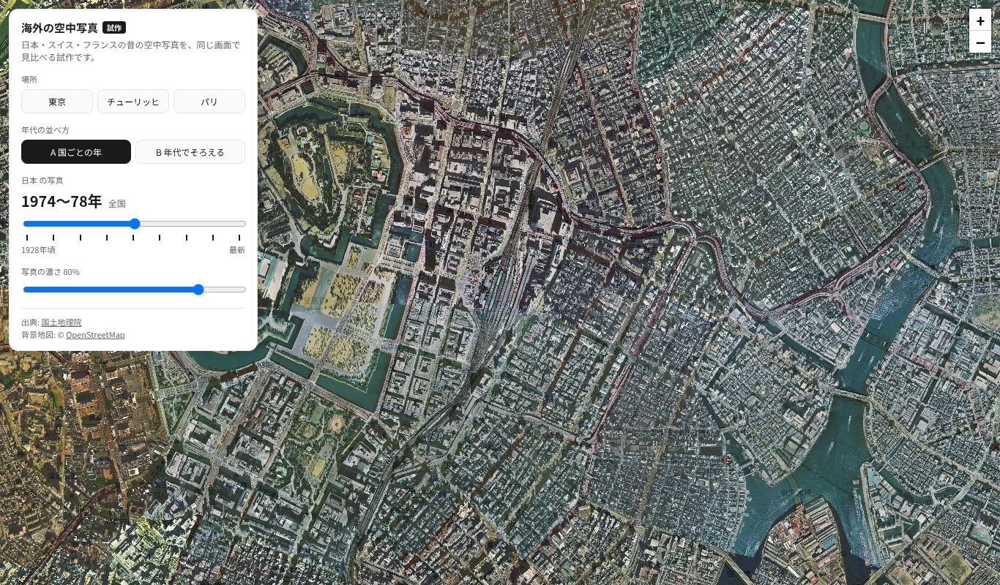
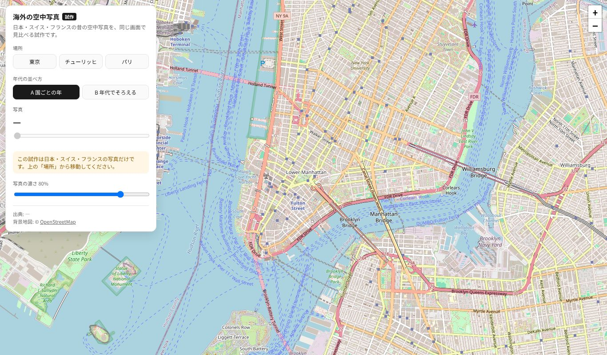
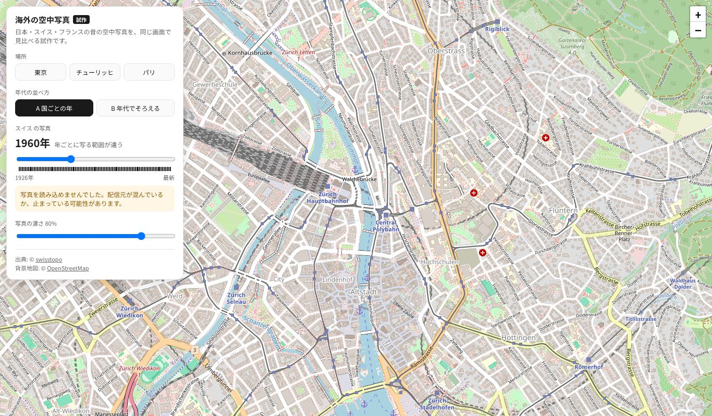
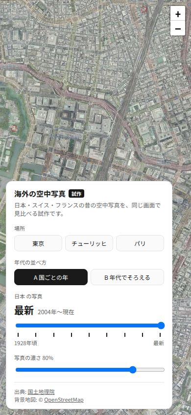

# 海外の空中写真 試作 確認結果（2026-10-27）

- 対象: `overseas-test.html`（リンクを張らずに公開: https://immersamap.github.io/overseas-test.html）
- テスト設計: [`docs/test_design/overseas_prototype.md`](../test_design/overseas_prototype.md)
- 実行: `.venv/bin/python tests/e2e/overseas_prototype_check.py --shots docs/test_results/20261027_overseas`
- 環境: Python 3.14.4・Playwright 1.64.1・Chromium（ヘッドレス）。配信元へ実際に接続

## 結果: 38/38 PASS

| 区分 | 件数 | 結果 |
|---|---|---|
| 正常系 N1〜N7 | 26 | すべて PASS |
| 異常系 E1〜E4 | 12 | すべて PASS（E2・E3 は注入が効いたことも確認） |
| 既存のトップページ（P2） | 79 | すべて PASS（`tests/e2e/top_page_check.py`） |

- P1: 既存ファイルの変更は `.gitignore`（`.venv/` を追加）・`_config.yml`（テストコードを非公開リストに追加）・`CLAUDE.md` だけ。既存のページと `sitemap.xml` は変えていない
- P3・P4: 公開後の確認は下の「公開後の確認」

## 途中で見つけて直したこと

1. **swisstopo の白いタイル:** 写真の無い所に 200 で真っ白な JPEG（668 バイト）が返り、地図に白い膜がかかった
   （1946年のチューリッヒは z16 以下がすべて白）。白いタイルを見分けて隠し、お知らせを出すようにした（N7）。
   1946年は全域をつないだ専用の層（`swissimage-product_1946`）に切り替えた
2. **テストの想定違い（N5 日本）:** 「1950・1990年代も空く」と書いたが、1945〜50年・1987〜90年の写真がかかるので、
   空くのは 2000・2010年代だけが正しい。実装ではなくテストの想定を直した
3. ズームのボタンが操作板に隠れていたので、右上へ移した

## 画面写真

| 場面 | 写真 |
|---|---|
| チューリッヒ 1946年（A） |  |
| チューリッヒ 1926年（写真なしの案内） |  |
| チューリッヒ 1940年代（B） |  |
| パリ 1950〜65年（A） |  |
| パリ 1920年代（B・写真なし） |  |
| 東京 1974〜78年 |  |
| ニューヨーク（対象外） |  |
| 配信元が全部失敗 |  |
| スマホ |  |

## 見て分かったこと

- **スイス・フランスとも、今の地図（OSM）の道路・川と写真がよく重なる。** 日本と同じ方式で足せる
- パリ 1950〜65年は、画面の一部しか写真が来ないことがある（読み込みが遅い）。数秒待つと埋まる
