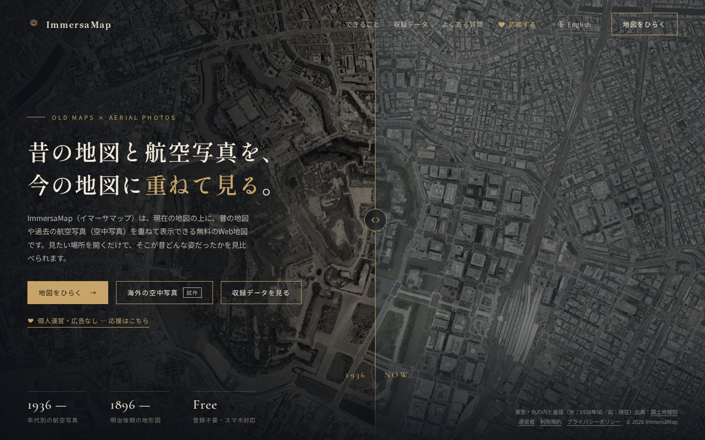
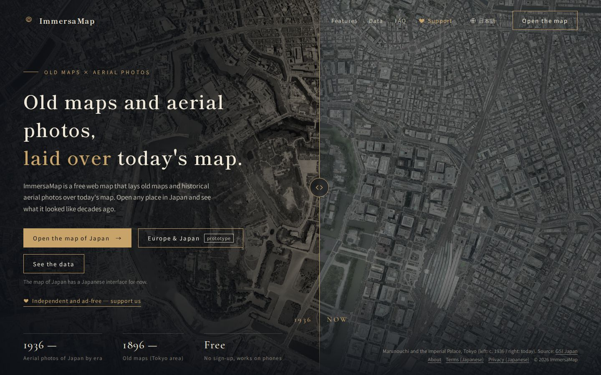
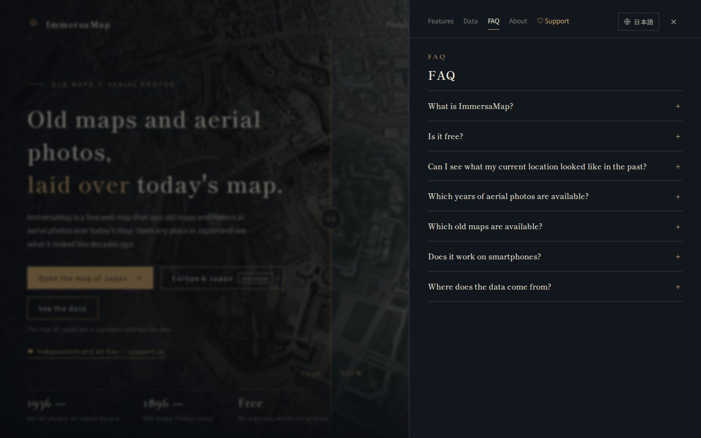
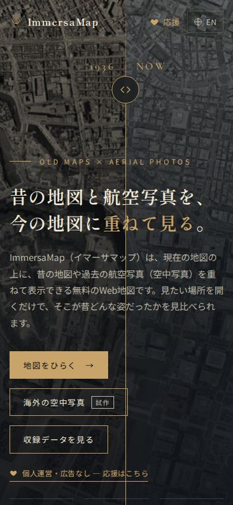
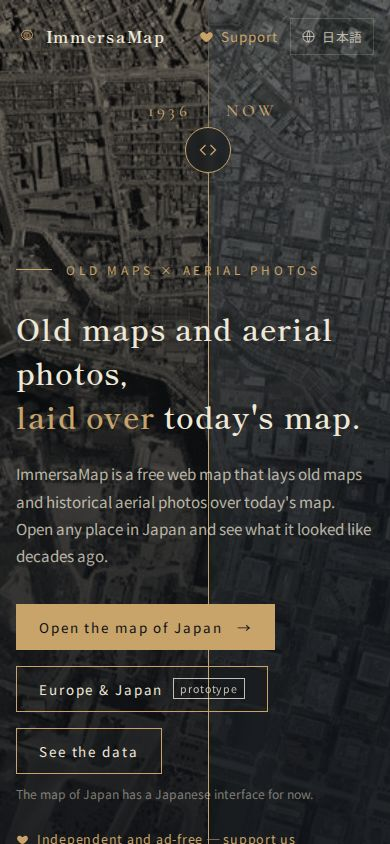
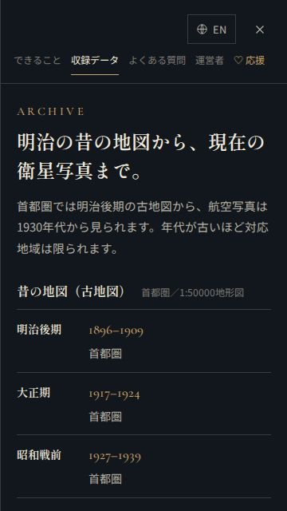

# 試作トップ（top-test.html）確認結果（2026-10-27）

- 対象: `top-test.html`（日本語／英語・海外の空中写真への入口）
- 設計・レビュー: [`docs/design/top_test_prototype.md`](../design/top_test_prototype.md)（実装前 R1〜R5・実装後 F1〜F4）
- テスト設計: [`docs/test_design/top_test_prototype.md`](../test_design/top_test_prototype.md)
- 実行: `.venv/bin/python tests/e2e/top_test_check.py --shots docs/test_results/20261027_top_test`
- 環境: Python 3.14.4・Playwright 1.64.1・Chromium（ヘッドレス）。`file://` で開く

## 結果: 65/65 PASS

| 区分 | 結果 |
|---|---|
| 正常系 T1〜T3・T5・T9・T11、全体のエラー確認 | すべて PASS |
| 異常系・画面の大きさ T4・T6・T7・T10 | すべて PASS |
| 検索に出さない T8 | PASS |
| 今のトップ（P2: `tests/e2e/top_page_check.py`） | 79/79 PASS |

- P1: 既存の HTML・`sitemap.xml`・`robots.txt`・`_config.yml` は変えていない（足したのは `top-test.html`・テスト・ドキュメントだけ）

## 途中で見つけて直したこと

1. **360px の英語でヘッダーが 2.7px はみ出す**（T6 で発見）: スマホのメニューのすき間を 14px → 10px にした
2. **テストの誤り**: 英語の FAQ の件数を、全タブを開いたあと（FAQ が閉じた状態）で数えていた。FAQ を開いたときに数えるよう直した（実装は変えていない）
3. **実装後レビューの F1〜F4**: パネルのタブが切れる・英語で日本だけと分からない・JavaScript が無いとき空のボタンが出る。直して T11 などを足した。
   F1 は最初の直しでも 360px の日本語で 10px 足りなかったので、タブの文字を少し小さくした（.8rem → .76rem）

## 画面写真

| 場面 | 写真 |
|---|---|
| PC・日本語 |  |
| PC・英語 |  |
| PC・英語の FAQ |  |
| スマホ・日本語 |  |
| スマホ・英語 |  |
| スマホ・日本語のパネル（タブが5つとも見える） |  |
