# 海外の空中写真 試作 スマホの操作性レビュー（2026-10-27）

- 対象: `overseas-test.html`
- きっかけ: オーナーから「画面の操作性は改善が必要。スマホだからかもしれない。UI/UX デザイナーのレビューを通すこと」
- やり方: 3人の模擬レビュワーが、実際の画面を Playwright（`file://`・タッチ有効）で通しで操作し、
  寸法を測ったうえで議論した。指摘は「どこが・どう壊れるか」を数字で言えるものだけにしている
  - A: モバイルファーストの観点（L. Wroblewski 風）
  - B: ユーザビリティの観点（Nielsen Norman Group 風）
  - C: 地図プロダクトの設計者（Google Maps／Mapbox 風）
- 確かめた画面: 縦 390×844・小さい縦 360×640・横 844×390・PC 1280×800

## 1回目の指摘（直す前）

| ID | 場所 | どう壊れるか | 重大度 | 直したこと |
|---|---|---|---|---|
| F1 | 年のスライダー（スイス 100段） | 幅 306px に 100段で 1年あたり約3px。指の当たる幅（約40px）に13年分が入り、狙った年を選べない | 高 | ◀▶ で1つずつ送る。シートを開くと年のチップ（高さ 40px）で選べる |
| F2 | 操作板（縦） | 操作板が y=368〜832 を覆い、地図は上の 44% しか見えない。畳めない | 高 | 下に畳めるシートにした（畳んで 237px） |
| F3 | スライダーを動かしている間 | 1段ごとに写真の層を作り直し、最新→1946年でタイル 972 件。層を外すたびに背景がちらつく | 高 | 動かしている間は年の表示だけ。離したときか止まって 250ms 後に読む（12 件に減った）。前の層は新しい層が読み終わるまで残す |
| F4 | 小さい画面 360×640 | 中身 466px に対し見える高さ 350px。濃さが画面の外に出て、あることに気づけない | 中 | 畳んだシートは 235px で収まる。濃さは開いた側 |
| F5 | 横画面 844×390 | 操作板が左 340×366px を覆い、出典が画面の外 | 中 | 左の幅 300px の帯にした。畳んだ状態で出典まで見える |
| F6 | 場所のボタン（6か所以上） | 1つ 46px 幅で文字が3行に折れ、操作板が 96px あふれる | 中 | 画面の上端に横に流す1行（高さ 40px） |
| F7 | 今と昔の見比べ | 濃さのスライダー（高さ 16px）を 80%→0%→80% と往復させるしかない | 中 | 「今と比べる（押している間）」ボタン |
| F8 | お知らせ欄 | お知らせが出ると出典が見えなくなる | 低 | シートが伸びて出典は見えたまま |
| F9 | 押す部分 | チップ 33px・＋− 30px で、推奨の 44px より小さい | 低 | ＋−・◀▶・比べるは 44px、チップは 40px |

## 2回目の指摘（実装後）

| ID | 場所 | どう壊れるか | 重大度 | 対応 |
|---|---|---|---|---|
| N1 | 360×640 でシートを開いたとき | 見出しと説明（約 95px）が上にあるため、A/B の切替（y=656）と濃さが画面の外に出る。A/B はオーナーが触って決める本題 | 中 | 見出しと説明をシートの一番下へ移した（A/B は y=572 で画面内） |
| N2 | 場所のチップの塗り | バルセロナにいるとマドリードも塗られる（判定がスペイン全体のため） | 低 | **今回は直さない**（同じ国に2か所あるのはスペインだけ。地域が増える次の段階で見直す） |
| N3 | 対象外の場所（ニューヨーク） | スライダーは止まるのに「今と比べる」は押せて、何も起きない | 低 | 写真が無いとき（対象外・写真の無い年代）は押せなくした |
| N4 | 開いたシート（縦） | 説明文と「スイス の写真」の間が 0px | 低 | N1 で見出しが下へ移り解消 |

案との違い（3人とも受け入れた）:
- PC にも「今と比べる」を出した（パネルは 641px で画面 800px に収まる）
- 出典は Leaflet の出典欄へ移さず、シートの下に常に出す（畳んでも見える）

## 変えなかったもの

データ・年の一覧・国の判定（地図の中心）・白いタイルの判定・お知らせの文言・A と B の両方を残すこと・PC の左上パネルの配置

## 画面写真

| 場面 | 写真 |
|---|---|
| 縦・畳んだ状態 | 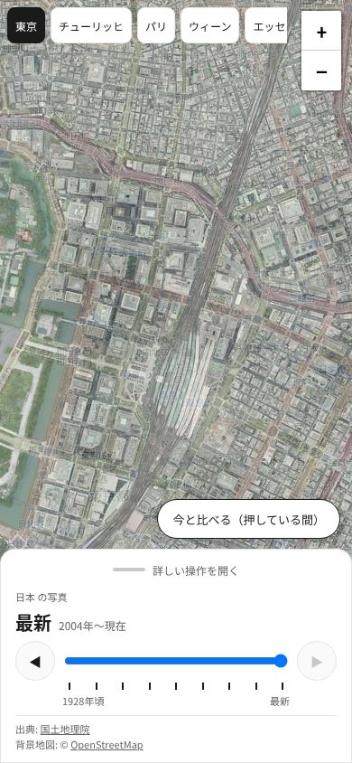 |
| 縦・開いた状態（チューリッヒ 1946年） | 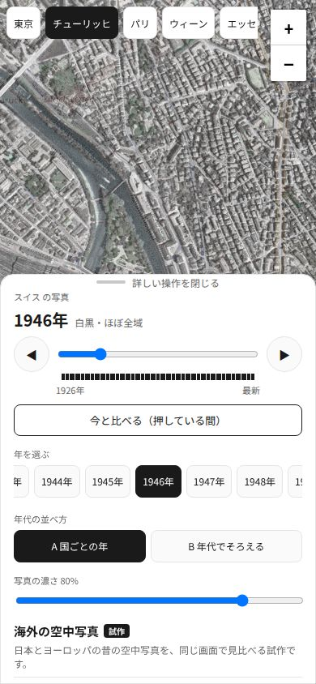 |
| 小さい縦・開いた状態 | 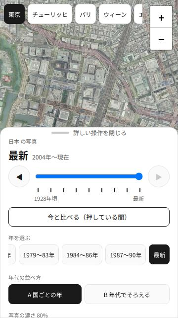 |
| 横画面 | 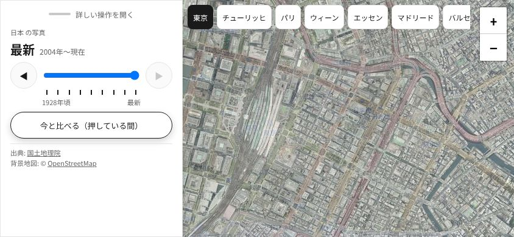 |

## 3回目（オーナーがスマホで確かめた意見を受けて）

オーナーの意見:
1. 下の操作パネルが少し大きい
2. 重ね合わせは、公開中のサイト（/map/）と同じく透過度を指定するほうがよいのでは
3. 場所の名前だけでは国が分からない（国旗がほしい）。ただし、データが増えるたびにボタンが増えるのはいまいち

変えたこと:

| 意見 | 変えたこと | レビューでの実測 |
|---|---|---|
| 1 | 畳んだシートを「年・◀スライダー▶・目盛り・両端の年・出典1行」だけにした（国名は場所のボタンへ） | 237px → 162px。地図は画面の約81% |
| 2 | 「今と比べる（押している間）」をやめ、濃さを /map/ と同じ地図の右側の縦スライダーにした | 3人とも「分かる」。好きな濃さで止めておけるので、押している間だけより見比べに向く。両方のページで操作がそろう |
| 3 | 左上に「[国旗] 国名　場所を変える ▾」のボタン1つ。押すと国ごと（国旗付き）の一覧。国旗は SVG（Windows は国旗の絵文字を出せない） | 23か国・41都市を入れて試しても崩れない（一覧は 420px で止まり中でスクロール） |

3回目の指摘と対応:

| ID | 場所 | どう壊れるか | 重大度 | 対応 |
|---|---|---|---|---|
| N1 | 濃さの縦スライダー | 枠は幅 40px なのに、指が効くのは中央の 16px だけ | 中 | 指の効く幅を 40px にした |
| N2 | 横画面の左の帯 | 中身は y≈172 までなのに帯が画面の高さいっぱいで、下の半分以上が空白 | 低 | 帯の高さを中身に合わせた（170px） |
| N3 | 場所の一覧 | 今いる国に印が無い。国が増えると探しにくい | 低 | 今いる国の行に印を付け、そこまで送る |
| N4 | 畳んだシートの目盛り | 両端の年を隠したので、100段の目盛りが何年から何年か分からない | 低 | 両端の年を小さく1行で戻した |

国が増えたときの方針（3人の合意。今は6か国なので入れていない）:
- 10か国を超えたら、一覧に地域ごと（ヨーロッパ・アジア…）の見出しを付ける
- 30か国を超えたら、検索欄を考える

前回の N2（同じ国の2都市が同時に塗られる）は、場所のボタンを国の表示にしたため無くなった。

| 場面 | 写真 |
|---|---|
| 縦・畳んだ状態（濃さは右） |  |
| 場所の一覧 |  |
| 横画面 |  |

## 4回目（年の並べ方を1つにし、英語を足した）

オーナーの意見:
1. 「国ごとの年」「年代でそろえる」の意味が分からない。国をまたいで見る使い方は想定しない。場所を選んだら、そこにある年をスライダーで選べればよい
2. 外国の人も見ることを考えると、英語表記のほうがよい

変えたこと:
- A/B の切り替えをやめ、その場所にある年だけを並べる（もとの A）
- 日本語／英語の切り替え。右上（ズームの上）に「English／日本語」のボタン。最初はアドレスの `?lang=`、無ければブラウザの言葉
- スマホでは場所のボタンの幅に上限を付け、国名が切れるときだけ「場所を変える」を ▾ だけにする
- 英語の「Opacity」が濃さの枠からはみ出したので、見出しの文字を 10px にした（実装中に画面写真で発見）

レビュワー: A モバイル優先（Wroblewski 風）・B 使いやすさ（NN/g 風）・C 地図プロダクト（Google Maps／Mapbox 風）・**D 多言語化の専門家（今回追加）**。
日本語・英語の両方を 390×844・360×640・844×390・1280×800 で操作し、7か所を回って測った。

| ID | 場所 | どう壊れるか | 重大度 | 対応 |
|---|---|---|---|---|
| R1 | 国を移ったときの年の選び直し | 基準が「直前の国で選ばれていた年」だったため、スイス 1927年 → パリ（1950〜65年）→ スイスに戻ると 1950年。ウィーン 1956年 → 市の外 → 戻ると「最新」。選んだ年に戻らず、気づかずに別の年を見る | 中 | 利用者が選んだ年（`wantYear`）を覚え、それに近い年を選ぶ。対象外を経ても消さない。E2E に行き来・対象外を経る場合を追加 |
| R2 | 国の判定の枠 | 四角い枠のため、シュトゥットガルト（48.78, 9.18）で「🇫🇷 France」と出て、IGN のタイルが全部失敗し「配信元が混んでいるか、止まっている」と誤ったお知らせが出る。トリノ・ブリュッセル・アンドラもフランス、ミラノはスイス | 中 | スイス・フランスを国境をなぞった多角形にした。上の都市は対象外になる。E2E に17都市の判定（N10）を追加 |
| R3 | 360×640 でシートを開いたとき | シートの上端 y=304 が濃さの枠（162〜344）の下 40px にかぶり、「80%」と 0% 側が隠れる | 低 | 開いたシートの高さを `min(60vh, 100vh − 354px)` までにし、入りきらない分はシートの中で送る |

確かめて問題がなかったこと（レビューの記録から）:
- 場所のボタンと言葉のボタンは、4サイズ × 2言語 × 7か所のどれでも重ならない（最小の隙間は 25px）
- 縦は 言葉 y=10〜50・ズーム 56〜148・濃さ 162〜344 で重ならない。横は濃さが右下
- 言葉を切り替えても場所・年はそのまま。`?lang=` がアドレスに付き、再読み込みしても同じ言葉
- 英語の訳の抜け・文字の切れ・ボタンの文字とお知らせの食い違いは無い

判定: A は R3、B は R1、C は R1（と R2 の記録）を条件に LGTM、D は LGTM。R1〜R3 を直したので、全員 LGTM。
R2 は案の①（多角形）だけ入れた。②（全部失敗したときに、国の端なら別の文言にする）は、①で対象の外に出るようになったため入れていない。

| 場面 | 写真 |
|---|---|
| PC・英語 | 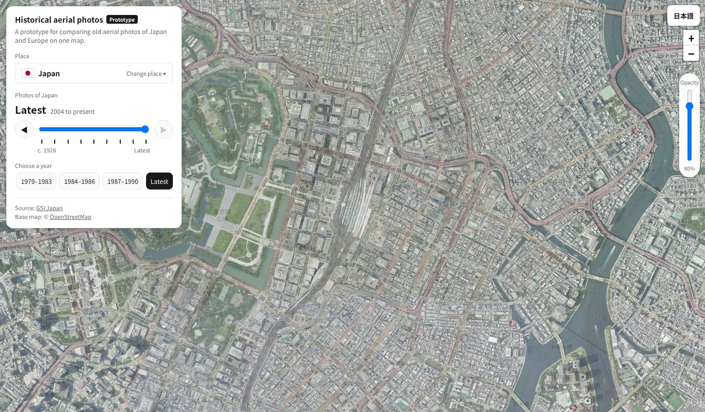 |
| 縦・英語（いちばん長い国名） | 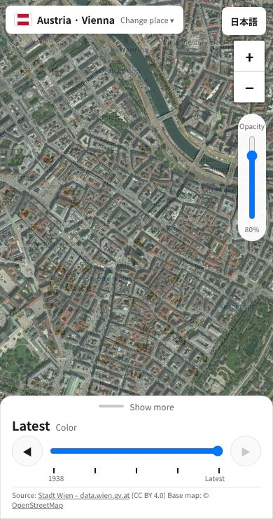 |
| 縦・日本語・開いた状態 | 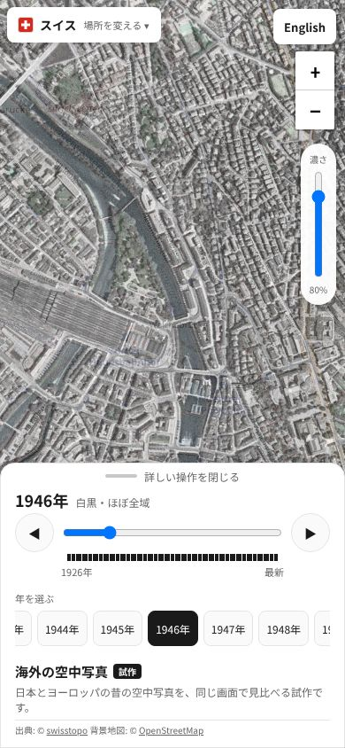 |
| 小さい縦（360×640）・開いた状態 | 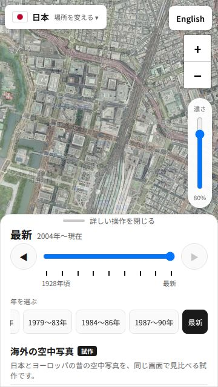 |
| 横画面 | 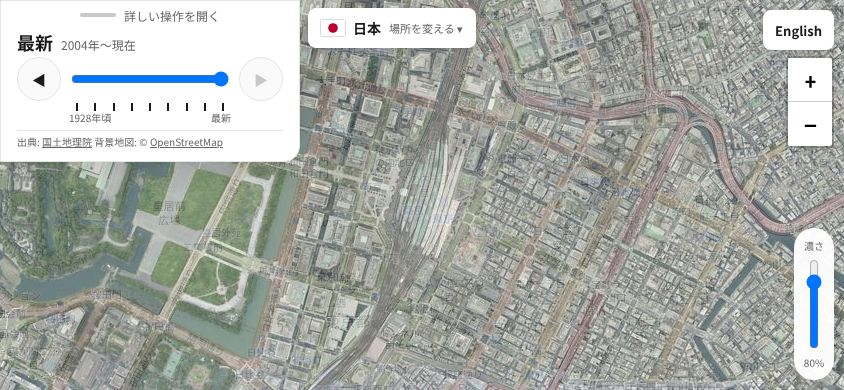 |

## 5回目（地域と古地図を足した）

オーナーの指示: 調査で「すぐ足せる」とした地域・古地図を入れる。

変えたこと:
- 地域: カタルーニャ・バスク州・フランドル・NRW州・ベルリン・バイエルン。ルール地方は NRW州の写真も足して 76 の年
- 古地図: スイス（1844〜2021）・フランス（カッシーニ図・参謀本部図）・NRW州（3つ）・バイエルン（3つ）・スペイン（Minutas・マドリードの市街図 11枚）
- 年の行の右端に「空中写真｜古地図」の切り替え（古地図のある地域だけ）。選んだ年は種類ごとに覚える

レビュワー: A モバイル優先・B 使いやすさ・C 地図プロダクト・D 多言語化。4サイズ × 2言語 × 11か所 × 写真／古地図 × 最古／最新の 304通りを測った。

| ID | 場所 | どう壊れるか | 重大度 | 対応 |
|---|---|---|---|---|
| S1 | ルール地方の判定の枠 | 四角のためデュッセルドルフ・ヴッパータール・クレーフェルトも「ルール地方」になり、ルール地方連合の写真を使う 1952・1969年が「写真がありません」になる（NRW州には写真がある） | 中 | ルール地方を連合の配信範囲をなぞった多角形にした。デュッセルドルフ等は NRW州になり、全部の年が出る。N11 に8都市と「デュッセルドルフ 1952年が写る」を追加 |
| S2 | バイエルンの古地図 1808〜53年 | 場所の一覧から開くとズーム15で、全部空になり「地図がありません…ズームを変えて」と出る。寄れば出る手がかり（副題）は切り替えに押されて省略され、見えない | 中 | 年ごとに最小ズームを持ち、引いているときは「ズーム16以上に寄ると出ます（＋で寄る）」と出す。英語も同じ |

確かめて問題がなかったこと（レビューの記録から）: 304通りで横スクロール・はみ出し・ボタンの重なりは無し。畳んだシートは出典1行で 162〜166px、出典が長い所（NRW州・ルール地方）は最大 208px（360×640）でも濃さのスライダーより下。種類ごとの年の記憶・ブリュッセル（フランドル扱い）の写真・一覧の7か国・英語の訳は問題なし。

判定: A は S2、B は S1・S2、C は S1 を条件に LGTM、D は LGTM。S1・S2 を直したので全員 LGTM。

| 場面 | 写真 |
|---|---|
| スマホ・チューリッヒの古地図（切り替えあり） | 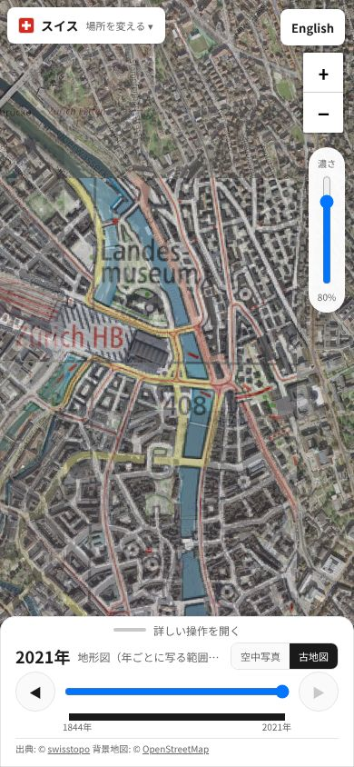 |
| 場所の一覧（7か国） | 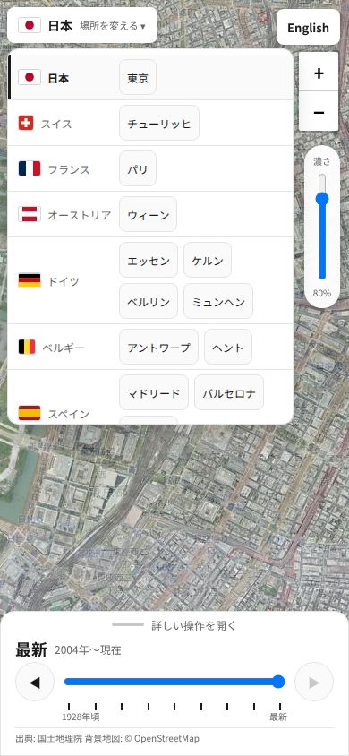 |
| パリの参謀本部図 | 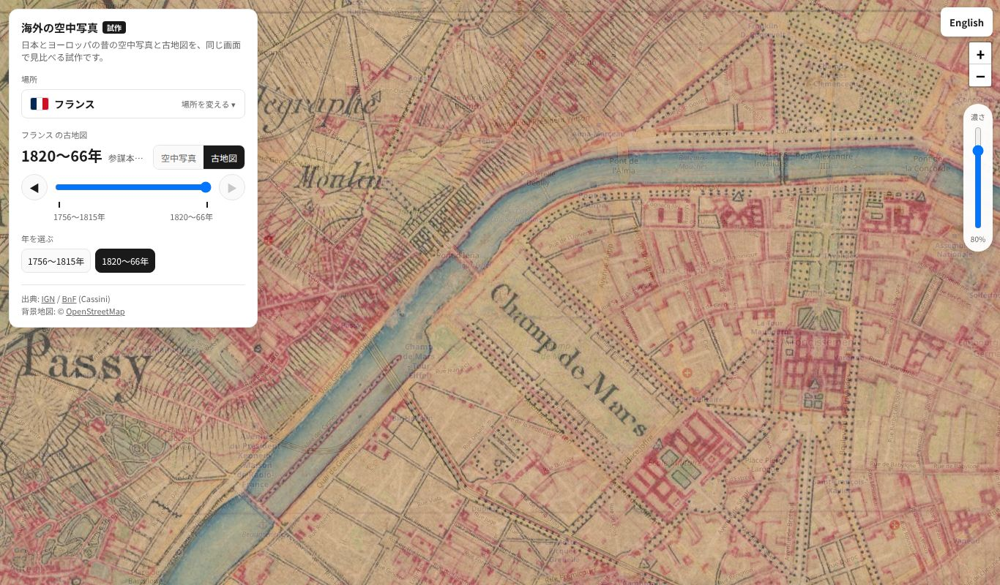 |
| マドリード 1656年の市街図 | 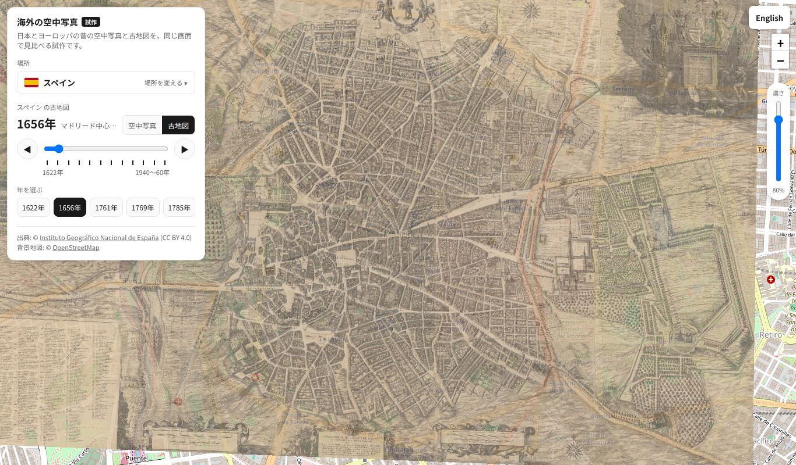 |
