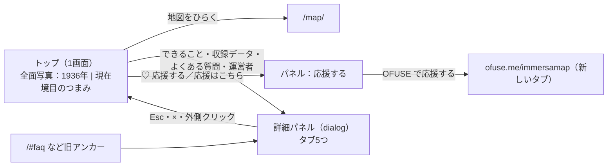

# トップページ刷新「ノワール」 UI・設計メモ（2026-10-11）

## 目的・背景

ユーザー要望：「PC で開いたときにスクロール無しで1画面に収めたい。もっとシックでおしゃれにしたい」。
旧トップは縦に長い LP（ヒーロー・定義文・できること・年表・使い方・FAQ・運営者・応援・CTA）だった。

案A「ノワール」（暗い全面写真＋金の細線）と案B「エディトリアル」（生成りの紙面＋額装写真）を
見本として作り、**案A** が選ばれた。旧トップの文章をパネルへ移すことも承認済み。

## 画面構成

| 領域 | 内容 |
|---|---|
| 背景 | 国土地理院 `ort_old10`（1936年頃）と `seamlessphoto`（現在）の丸の内・皇居周辺、z16 を 8×5 枚つないだもの。`images/hero/` に 1920px と 1280px を置き `srcset` で出し分け |
| 境目 | 上の1936年写真を `clip-path` で切り抜き、つまみ（`role="slider"`）のドラッグ・左右キーで動かす。読み込み後に1回だけゆっくり揺れて「動かせる」ことを示す（`prefers-reduced-motion` では揺れない） |
| 本文 | h1・説明文・「地図をひらく」「収録データを見る」・応援への一行 |
| 下帯 | 3つの数字（1936— / 1896— / Free）、写真の出典、運営者・規約へのリンク |
| パネル | できること（定義文・3つの特徴・使い方3ステップ）／収録データ（年表・データ出典）／よくある質問7件／運営者／応援する |

## 仮想レビュー（有識者観点）と対応

| 観点・レビュワー像 | 指摘 | 対応 |
|---|---|---|
| SEO（検索流入を見てきた担当者） | 1画面化で本文が消えると、9月に整えた検索向けの文章が失われる | 文章は削らずパネル内に残す。`<head>`（title・description・canonical・OGP・構造化データ）は旧版をそのまま移植。FAQ の構造化データと画面の質問が一致することを E2E で確認 |
| SEO | 旧アンカー（`/#faq` 等）で来た人が迷う | ハッシュで該当タブを開く。`#howto` は「できること」へ |
| アクセシビリティ | 境目のつまみがマウス専用になりがち | `role="slider"`・`aria-valuenow`・左右キーで操作可。演出は `prefers-reduced-motion` で止める |
| 地図・資料の扱い | 背景写真の出典が必要 | 下帯に「出典：国土地理院」を常時表示。収録データの注記にも記載 |
| 個人サービスの運営 | 応援の入口がスマホで見えない（案の段階でユーザーから指摘） | 上部に常時表示の「♡ 応援」、本文下の一行、専用タブを用意 |
| 性能 | 写真2枚で重くなる | 1280px 版（各約250KB）をスマホ向けに出し分け。フォントは既存＋Cormorant Garamond のみ |

## 異常系

| 状況 | 動き |
|---|---|
| 背景写真が読み込めない | 背景色 `#0D1015` のまま文字・ボタンは読める（白文字は暗背景前提で設計） |
| JavaScript が動かない | 本文・「地図をひらく」は使える。パネルは開かない（文章はHTML内にあるので検索エンジンには読まれる） |
| `<dialog>` 非対応の古いブラウザ | 主要ブラウザは対応済み（Safari 15.4+）。非対応ではパネルが開かない |
| 縦が低い PC 画面（〜700px） | 見出し・余白を詰める。`min-height:620px` 未満では縦スクロールを許す |

## テスト

`tests/e2e/top_page_check.py`（Playwright）。結果は `docs/test_results/20261011_トップページ刷新_確認結果.md`。
